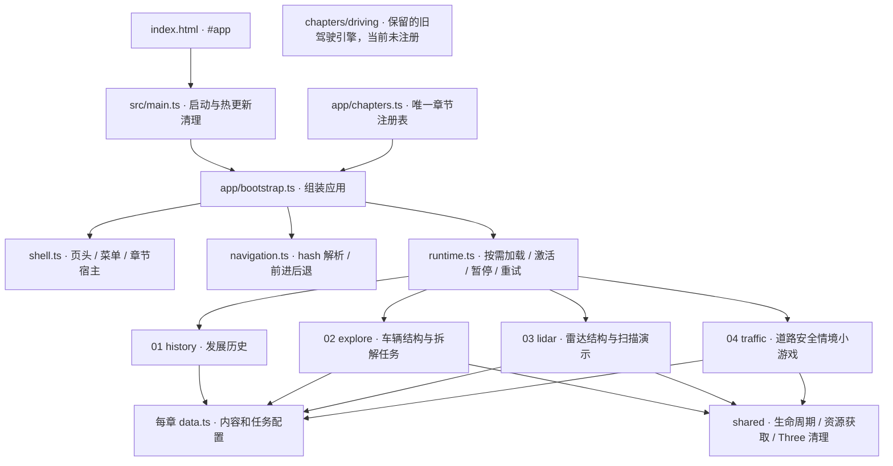
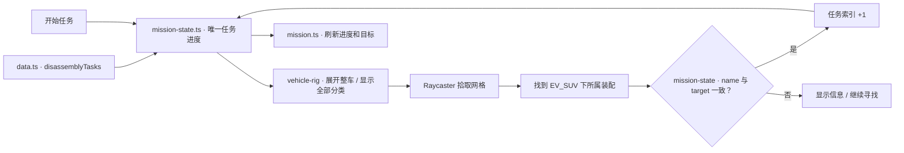
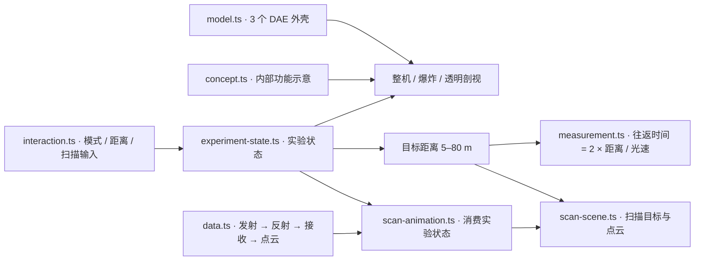
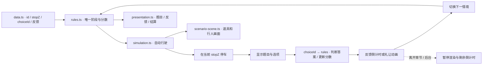
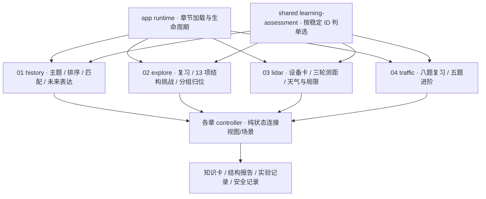

# 智驾博物馆：当前项目架构与内容修改地图

更新于 2026-11-08，反映模块化翻新后的实际代码。[翻新前架构](docs/architecture/2026-11-08-before-refactor.md)已归档。

01–04 已完成内部整理，并在原四个展厅内加入适合五六年级的学习活动。本文件描述已实现结构，详细修改路径见[内容与小游戏修改地图](docs/engineering/content-editing-guide.md)，本轮实现、验证及提交见[学习路线实施记录](docs/engineering/upper-primary-learning-progress.md)。下方扩展示例仅供后续参考。

项目使用 TypeScript + Vite 6 + Three.js，没有后端，也没有 React/Vue。01–04 各自拥有视图、内容和交互控制器；应用层负责注册、导航和生命周期。新增展厅不再修改一个几千行的入口文件。

## 1. 总体架构图



依赖规则：app 通过注册表加载章节；章节可以使用 shared；章节之间不互相导入控制器。内容与纯规则/状态文件不导入 DOM 或 Three.js。controller 连接输入、状态、UI 与三维表现；任务进度和分数只由规则状态保存。DOM 查询限定在本章 host 内；应用页头和菜单由 bootstrap 管理。

## 2. 实际目录

```text
src/
  main.ts                         # bootstrap 和 HMR dispose
  app/
    chapters.ts                   # 编号、标题、布局、视图、动态 import
    types.ts                      # ChapterDefinition / ChapterController
    shell.ts                      # 公共界面和章节容器
    navigation.ts                 # hash 解析与回退
    runtime.ts                    # 加载去重、激活、暂停、超时、重试、销毁
    bootstrap.ts                  # 导航事件、菜单、错误展示与应用装配
  chapters/
    history/                      # 01
      data.ts                     # 14 件展品和档案图片信息
      view.ts                     # 报刊外壳模板
      render.ts                   # 时间线与档案 HTML，从展品数据生成
      controller.ts               # 填充视图、年份点击和滚动定位
      learning-data.ts            # 5 主题、5 事件、3 匹配题与未来选择
      learning-state.ts           # 排序、理解确认、Unicode 理由与知识卡条件
      learning-view.ts            # 学习卡、可拖动/按钮排序、问答与成果
      viewport.css / gallery.css
    explore/                      # 02
      data.ts                     # 系统文案、装配名、分类、任务、动力流程
      view.ts                     # 结构展厅模板
      scene.ts                    # 相机、灯光、道路、渲染器、轨道控制
      focus.ts                    # 聚焦与对象分类策略
      mission.ts                  # 拆解任务面板渲染
      mission-state.ts            # 三步找部件任务推进与重复操作门控
      powerflow-state.ts          # 动力故事阶段、时间和播放状态
      vehicle-rig.ts              # 装配、爆炸、开合、灯光和透明度动作
      powerflow-scene.ts          # 动力故事三维效果
      learning-data.ts / learning-targets.ts # 功能复习、13 项任务与真实/教学目标
      learning-state.ts / learning-view.ts   # 找目标+功能题、替代学习与结构报告
      assembly-state.ts          # 四步分组归位，取消恢复与完成门控
      camera-observation.ts      # 进入前视角/轨道约束快照，取消后精确恢复
      controller.ts               # 拾取、加载、输入和各层接线
      styles.css
    lidar/                        # 03
      data.ts                     # 8 个部件说明、4 个原理步骤
      view.ts                     # 雷达展厅模板
      model.ts                    # Collada 获取 / XML 修正 / 材质工具
      scene.ts                    # 相机、灯光、展台、场景分组
      concept.ts                  # 内部原理零件的示意几何
      scan-scene.ts               # 720 点模拟点云、光线、目标与扫描效果
      measurement.ts              # 光速与往返时间计算
      experiment-state.ts         # 模式、距离、扫描步骤和部件选择状态
      interaction.ts              # DOM/指针输入绑定，发送实验事件
      model-rig.ts                # 装配、爆炸、剖视的模型动作
      scan-animation.ts           # 按实验状态更新扫描画面
      controller.ts               # 模型加载、实验接线、UI同步和生命周期
      learning-data.ts / learning-state.ts   # 设备卡、三轮测距与局限题
      learning-measurement.ts     # 与显示缩放无关的米制距离和区间
      learning-camera.ts          # 教学镜头与迟到模型拟合的所有权及恢复
      learning-world.ts / weather-state.ts   # 四种教学目标与定性天气示意
      learning-view.ts            # 先判断后揭示、解释与实验记录
      styles.css / exhibit.css
    traffic/                      # 04
      data.ts                     # 8 个情境、答案、反馈、选项排序
      view.ts                     # 道路体验模板
      primitives.ts               # 标牌、信号灯、行人等基础构件
      scene.ts                    # 道路、城市、信号和初始车辆
      rules.ts                    # 答题、计分、阶段和计时效果指令
      simulation.ts               # 本章车辆、行人和环境运动步进
      scenario-scene.ts           # 按情境 ID 设置道具与消费世界状态
      presentation.ts             # 题目、反馈、按钮和结算展示
      controller.ts               # 规则、计时器、运动与展示接线
      learning-data.ts / learning-view.ts   # 按旧题 ID 关联复习与进阶反馈
      practice-state.ts           # 五题观察→决策→反馈→总结，独立于旧分数
      practice-scene.ts           # 独立场景组，退出恢复旧道路与相机
      styles.css
    driving/                      # 旧驾驶小游戏，尚未接入导航
      scene.ts / controller.ts / styles.css / bridge.css
  shared/
    lifecycle.ts                  # 事件清理、可暂停计时器、帧循环
    assets.ts                     # 部署基路径、可取消获取、请求超时
    gltf.ts                       # GLB 获取、解析和迟到资源处理
    three-resources.ts            # 去重释放几何/材质/纹理、实例缓冲、阴影与上下文
    webgl.ts                      # 上下文丢失和章节错误事件
    dom.ts                        # 复用的文本更新函数
    learning-assessment.ts        # 小型纯单选判定，稳定 ID 和无效选择检查
  styles/
    foundation.css / responsive.css / museum.css / navigation.css
    runtime.css                   # 加载与错误提示
  styles.css                      # 保持 CSS 次序的 import 清单
  game.ts / lidar-explorer.ts / traffic-chapter.ts  # 旧入口兼容适配
tests/
  unit/                           # 四章规则/动作、运行时、计时、请求、内容完整性
  e2e/                            # 四章独立体验验收及跨章降级、恢复、暂停
docs/
  development/                    # history/explore/lidar/traffic-content.md
  engineering/content-editing-guide.md # 四章内容与小游戏维护索引
```

foundation.css 和 museum.css 保留了早期混合的基础样式，章节专用覆盖样式已归入对应目录。**不要随意调换 styles.css 的导入顺序**：原始文件包含 CSS layer 与后续无 layer 覆盖，本次保留了原有 521 个顶层节点的内容与顺序，其中 509 个是规则或 at-rule，12 个是注释。

## 3. 01–04 与小游戏的修改位置

| 模块 | 当前组成 | 主要修改文件 |
| --- | --- | --- |
| **01 / history** | 原 14 展品和时间线；5 主题、排序、3 匹配题、未来表达与知识卡 | data/render 维护原展品；learning-data/state/view 维护新任务 |
| **02 / explore** | 原聚焦、拆解、开合、动力故事与 3 任务；3 复习题、13 项结构挑战、分组归位 | 原 data/mission/powerflow 保留；learning-targets 维护节点；learning-state/assembly-state 维护挑战 |
| **03 / lidar** | 原模型/4 步/5–80 m/720 点演示；设备卡、三轮测距、天气与局限实验 | 原 measurement/experiment-state 保留；learning-data/measurement/world/state 与 weather-state 维护新实验 |
| **04 / traffic** | 原 8 情境/8 分；原题复习、独立五题进阶与安全记录 | 原 data/rules/simulation 保留；learning-data/view 与 practice-state/scene 维护新任务 |
| **旧 driving** | 三车道避障、能量、自动驾驶、碰撞、重启 | chapters/driving/；需接入生命周期适配后才能注册为新展厅 |

### 02：找部件小游戏



现有目标依次为 BatteryPack、ADAS、Cabin。指示器和总数从任务配置产生。模型装配 name 是关联键，添加目标时先确认 GLB 内的名称，不要用中文显示标题代替。

动力故事由 powerflow-state.ts 维护播放阶段，powerflow-scene.ts 消费状态更新效果。阶段从0、1.2、2.55、3.45秒开始，总时长5秒；离开章节结束正在播放的故事并标记已播放，重播从零开始。

### 03：扫描演示



真实外壳为 VLP16_scan、VLP16_base_2、VLP16_base_1；内部 5 类零件是教学概念结构。点云由代码生成，不是实测数据。模型缺失时仍可操作概念扫描，降级提示会持续保留。扫描每1.3秒推进一步，手选步骤保持；重置恢复装配、停止扫描、清空选择并复位相机，保留距离（60m重置后仍为60m）。

### 04：道路情境小游戏



八个情境 id：red-light、pedestrians、yellow-light、school-zone、green-pedestrians、queue、construction、ambulance。scenario-scene.ts 中的场景设置按 id 关联显示状态。新增情境时同步增加道具设置，保证负 Z 行驶的 stopZ 依次递减，每题保留一个正确答案。规则通过 choiceId 判断选项，每题1分、总分8；重复作答或继续不推进两次。普通反馈2300ms，行人过街4.8秒，过街后反馈550ms。

## 4. 生命周期与故障处理

```typescript
interface ChapterController {
  setActive(active: boolean): void;
  dispose(): void;
}
```

控制器创建时 inactive，由 runtime 激活。再次进入复用已加载控制器，保留操作状态。同章并发加载会去重，晚到结果保持 inactive；应用销毁后的迟到结果会释放，包括初始化已结束但尚未交付控制器的微任务窗口。

旧 setupLidarExplorer 入口仍自动激活，返回可调用的 disposer；旧 setupTrafficChapter 入口保留 chapter:change 订阅，并在销毁时取消。新应用直接加载 mount，不依赖旧的全局事件。

| 条件 | 当前处理 |
| --- | --- |
| 隐藏章节或后台文档 | 停止渲染；04 反馈倒计时保留剩余时间，回来再继续 |
| 初始化超过 30 秒 | 本章显示错误并提供重试，迟到结果不会激活 |
| 02 GLB 请求失败 | 模型区提供重新加载按钮 |
| 03 任意 DAE 请求失败 | 释放已加载外壳，继续概念演示并保持降级提示 |
| 04 GLB 请求失败 | 示意车继续道路体验 |
| 初始化、渲染异常或 WebGL context loss | 隔离当前章，导航仍可用；重试时更换视图和 canvas |
| 章节代码分片失败 | 重新加载此页，处理失败模块缓存和旧部署分片 |
| HMR 或销毁 | 先释放场景纹理、几何、实例缓冲和阴影，再销毁渲染器及上下文；清理监听器、观察器和计时器 |

HTTP 请求与响应体读取均有 30 秒超时，可随章节销毁取消；GLTF 解析后检查取消状态并释放迟到资源。Three core 与 renderer 分别分包，01 不加载三维依赖。部署可用率和服务端容灾需要结合未来托管环境设计。

## 5. 后续展厅接入示例（本轮不执行）

1. 创建 src/chapters/design/，至少包含 view.ts、controller.ts 和所需 data.ts、styles.css。
2. controller 导出 mount(host)，返回 ChapterController；初始化时不启动循环，DOM 查询和事件限定于 host，资源有清理入口。
3. 在 src/app/chapters.ts 导入 designView，增加以下注册项。菜单、编号、总数、深链和前后退自动支持新章。
4. 在 src/styles.css 末尾引入新样式，限定于 .chapter--design。
5. 添加规则与浏览器测试，执行 npm run check。

```typescript
{
  id: 'design', number: '05', title: '设计工坊',
  subtitle: '我的未来汽车', label: '未来汽车设计',
  immersive: false, view: designView,
  load: (host, signal) => loadChapter(
    () => import('../chapters/design/controller'), host, signal,
  ),
}
```

这是供维护者查阅的后续接入示例，当前没有增加 05。本轮教学内容进入原 01–04；05/06 需要另外设计。

## 新学习内容的数据流



运行教学文案和答案以各章 `learning-data.ts` 为唯一来源，JSON 准备稿只供参考。题目 ID、选择 ID、模型节点引用是关联键，中文标题可以独立修改。单选判定不管理章节进度；完成、重试与主动继续在各章纯状态模块中处理。

成果在已挂载控制器内存中保存；普通切章后返回保留草稿与成果，刷新、页面退出（包括浏览器缓存返回）或故障重建后重置。原玩法的重置与新任务重置分开。02 的毫米波雷达为明确标注的教学热点，模型失败用图文学习并在报告注明；03 的点云与天气效果是教学示意；04 的进阶掌握数与原 8 分独立。

## 6. 资源与协作

| 资源 | 用途 |
| --- | --- |
| public/assets/history/ | 01 展品图片 |
| public/assets/yaojing-s9-optimized.glb | 02 模型：815 个原始 GLB 节点、24 个主要装配 |
| public/assets/yaojing-s9.glb | 04 与旧 driving 车辆 |
| public/assets/lidar/*.dae | 03 真实外壳 |
| public/assets/lidar/LICENSE、THIRD_PARTY_NOTICES.md | 许可与归属 |
| public/assets/*.blend | 编辑用源资产，浏览器不加载 |

01–04 协作者分别负责对应 chapters 目录。app、shared、styles.css、package.json 和构建配置由集成负责人统一修改，减少冲突。内容配置和交互逻辑可分开评审。

常用命令：npm run dev 启动；npm run test:unit 验证；npm run build 构建；npm run test:e2e 进行生产浏览器验证；npm run check 串联全部检查。

参考：[skill 调研](docs/engineering/skill-research.md)、[已完成的结构翻新方案](docs/superpowers/plans/2026-11-08-modular-reliability.md)、[前轮审查与验证](docs/engineering/review-findings.md)、[本轮独立审查](docs/engineering/domain-maintenance-review.md)、[已完成的01–04内部整理计划](docs/superpowers/plans/2026-11-08-domain-learning-expansion-plan.md)、[原教学改造计划（后续参考）](docs/superpowers/plans/2026-11-08-futuredrive-plan.md)。
