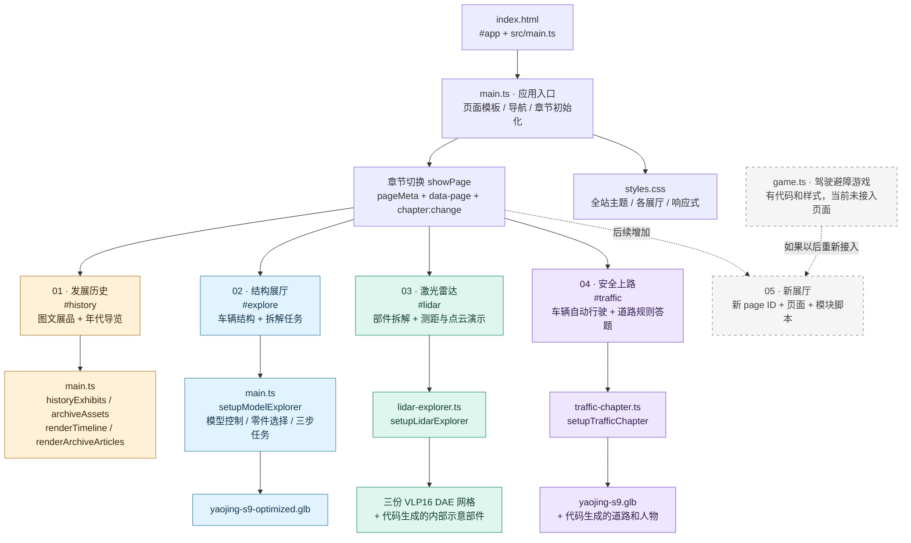
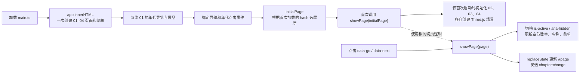
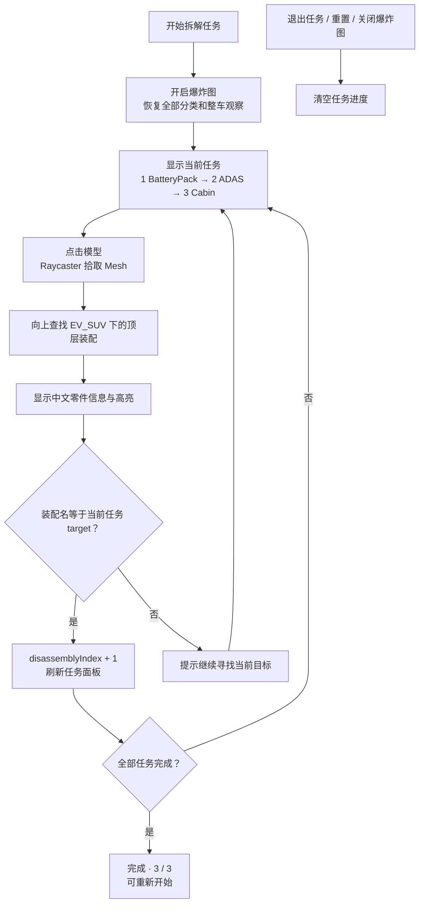
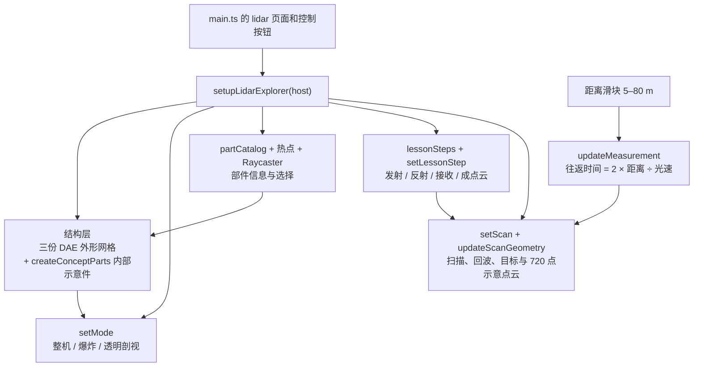
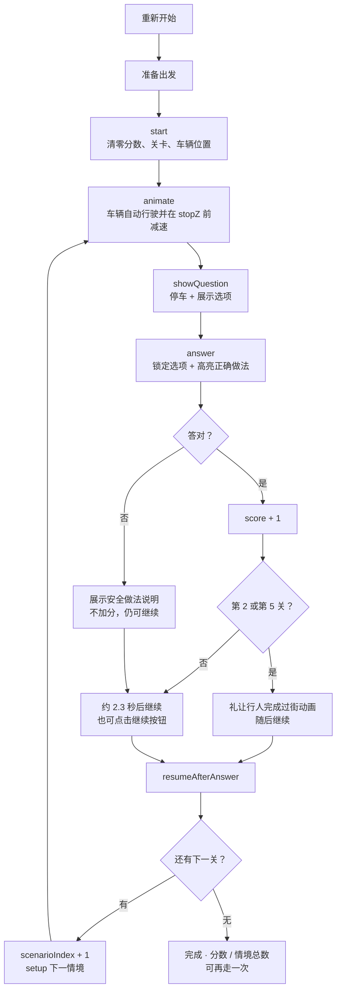

# 智驾博物馆：项目架构与内容修改地图

记录日期：2026-11-08。项目目录：`C:/Codex/citygame01`。

本文依据当前工作区代码（包含未提交改动）整理。**01–04 是现在实际接入的四个展厅；05 是后续扩展位置。**文中的“建议结构”和示例没有实施到应用中。

## 1. 先看总架构图



这是一个 **Vite + TypeScript + Three.js 的浏览器应用**。页面由原生 DOM 和模板字符串生成，当前没有 React/Vue、后端服务、数据库或统一状态管理库。游戏进度和分数保存在各模块运行时变量中，没有写入本地存储；刷新后重新初始化。

## 2. 01–04 对应哪些文件

| 展厅 | 页面 ID / 地址 | 页面模板 | 内容与交互逻辑 | 当前交互性质 |
|---|---|---|---|---|
| **01 发展历史** | `history` / `#history` | [main.ts:259](C:/Codex/citygame01/src/main.ts:259) | `main.ts` 的展品数据和两个渲染函数 | 年份导航、图文阅读，没有计分游戏 |
| **02 结构展厅** | `explore` / `#explore` | [main.ts:326](C:/Codex/citygame01/src/main.ts:326) | [setupModelExplorer:748](C:/Codex/citygame01/src/main.ts:748) | 3D 结构探索、三步拆解小游戏 |
| **03 激光雷达** | `lidar` / `#lidar` | [main.ts:456](C:/Codex/citygame01/src/main.ts:456) | [lidar-explorer.ts:89](C:/Codex/citygame01/src/lidar-explorer.ts:89) | 结构视图、扫描与测距实验，没有计分关卡 |
| **04 安全上路** | `traffic` / `#traffic` | [main.ts:540](C:/Codex/citygame01/src/main.ts:540) | [traffic-chapter.ts:144](C:/Codex/citygame01/src/traffic-chapter.ts:144) | 八个道路情境，选择答案、计分、继续行驶 |
| 保留的驾驶游戏 | 当前没有页面 ID 或菜单入口 | 当前应用模板没有游戏容器 | [game.ts:502](C:/Codex/citygame01/src/game.ts:502) | 手动避障、能量、自动驾驶、碰撞结算；当前不运行 |

**注意编号层级：**02 展厅内部的“01 整车、02 电池、03 座舱、04 智驾感知”是该展厅的四个观察模式，03 展厅内部的“01 发射、02 反射、03 接收、04 成点云”是四个原理步骤，都不是主导航中的展厅编号。

### 目录地图

以下树状路径均相对于上面的项目目录。

```text
citygame01/
├─ index.html                 浏览器入口、标题、SEO、#app
├─ package.json               dev / build / preview、依赖
├─ tsconfig.json              TypeScript 严格检查，检查范围 src/
├─ PROJECT_ARCHITECTURE.md     本文
├─ THIRD_PARTY_NOTICES.md      激光雷达模型的来源和许可说明
├─ src/
│  ├─ main.ts                 应用外壳 + 01–04 模板 + 导航 + 01、02 逻辑
│  ├─ lidar-explorer.ts       03 的 Three.js 场景与交互
│  ├─ traffic-chapter.ts      04 的道路场景、题库、答题流程
│  ├─ game.ts                 保留的驾驶避障游戏，当前未导入入口
│  └─ styles.css              全站和各模块样式，包含历史遗留游戏样式
├─ public/assets/
│  ├─ history/                01 的 JPG 照片与 SVG 科普图
│  ├─ yaojing-s9-optimized.glb 02 实际加载的车辆模型
│  ├─ yaojing-s9.glb           04 实际加载的车辆模型；game.ts 的默认模型
│  ├─ yaojing-s9-optimized.blend 车辆编辑源文件，浏览器不加载
│  ├─ lidar-assembled.glb      保留资源，当前 03 未引用
│  ├─ lidar-exploded.glb       保留资源，当前 03 未引用
│  └─ lidar/
│     ├─ VLP16_base_1.dae      安装底座
│     ├─ VLP16_base_2.dae      上盖
│     ├─ VLP16_scan.dae        扫描器
│     ├─ LICENSE              模型许可
│     └─ package.xml          上游模型包元信息
├─ dist/                      构建输出；修改源文件后重新构建生成
└─ node_modules/              安装的依赖
```

`public/assets/xxx` 在网页里通过 `/assets/xxx` 加载。当前这些资源地址从站点根目录开始；以后部署到子目录时，需要一并检查资源路径。

## 3. 应用如何启动和切换展厅



关键入口是 [pageMeta:623](C:/Codex/citygame01/src/main.ts:623)、[showPage:630](C:/Codex/citygame01/src/main.ts:630)、[initialPage:677](C:/Codex/citygame01/src/main.ts:677) 和 [模块初始化:1865](C:/Codex/citygame01/src/main.ts:1865)。

当前切换约定：

- 菜单按钮使用 `data-go="traffic"`，页内跳转按钮使用 `data-next="traffic"`。
- 页面容器使用 `id="traffic"` 和 `data-page="traffic"`，同时具有 `chapter` 类。
- `showPage()` 负责显示隐藏和导航状态，并发出 `window` 上的 `chapter:change`，消息为 `{ detail: { page } }`。
- 初次打开时识别 `#explore`、`#lidar`、`#traffic`，其他地址回到 `history`。
- 当前没有 `hashchange` 或 `popstate` 监听。修改地址栏 hash 本身不会调用 `showPage()`；菜单和 `data-next` 才是现有应用内切换入口。导航用 `replaceState`，也不会为每次切换新增浏览器历史记录。
- 所有展厅 DOM 和 02–04 场景在首次加载时初始化；不是进入展厅后才动态导入或加载。03、04 的返回控制器目前没有在 `main.ts` 中保存。

`chapter:change` 目前只是切页通知，各模块对它的响应不同，并没有统一的暂停机制；现有差异见第 11 节末尾。

## 4. 01 发展历史：内容怎样组成

```mermaid
flowchart LR
    data["historyExhibits<br/>14 件展品，数组顺序决定展示顺序"] --> rail["renderTimeline<br/>年份和标题按钮"]
    data --> articles["renderArchiveArticles<br/>展品卡片"]
    assets["archiveAssets<br/>图片、alt、图注等"] --> articles
    files["public/assets/history"] --> assets
    rail --> click["data-timeline-target = exhibit.id"]
    click --> scroll["scrollIntoView<br/>跳到同 ID 的展品"]
```

主要修改点：

| 你要改什么 | 修改位置 | 需要同步什么 |
|---|---|---|
| 增加年份、展品、调整顺序 | [historyExhibits:92](C:/Codex/citygame01/src/main.ts:92) | `id` 保持唯一；数组不会自动按年份排序 |
| 修改展品标题、正文、标签 | `historyExhibits` 的 `title / detail / story / badge / track` | 年代导览标题也使用同一份 `title` |
| 换图片和图片说明 | [archiveAssets:70](C:/Codex/citygame01/src/main.ts:70) + `public/assets/history/` | 展品的 `imageTitle` 必须匹配 `archiveAssets` 的键 |
| 修改欢迎语、首页大标题 | `main.ts` 的 `history` 页面模板 | 这是模板中的文字，不在展品数组里 |
| 修改展品布局 | [renderArchiveArticles:591](C:/Codex/citygame01/src/main.ts:591) + `styles.css` 中 `.archive-*`、`.history-*`、`.paper-*` | 保留年代跳转用的展品 `id` |

容易改错的地方：`autoEvents`、`sensorEvents`、`aiEvents` 仍在文件顶部保留，但当前两个渲染函数没有读取它们；`historyExhibits.eventTitles` 也没有参与当前渲染。**增加可见内容应改 `historyExhibits`。**`ArchiveMeta` 的来源、信用、长故事等字段并非全部显示，当前展品模板实际用的是图片、alt、图注和展品自己的正文。`imageTitle` 找不到图片映射时，会落入当前的“未来展望”占位版式。

## 5. 02 结构展厅：模型与拆解小游戏

### 5.1 功能组成

| 部分 | 代码锚点 | 作用 |
|---|---|---|
| 3D 场景、灯光、相机、轨道控制 | `setupModelExplorer()` | 拖拽旋转、缩放、模型展示 |
| 车辆加载 | [GLTFLoader:1458](C:/Codex/citygame01/src/main.ts:1458) | 加载 `/assets/yaojing-s9-optimized.glb` |
| 四种系统观察模式 | [focusCopy:682](C:/Codex/citygame01/src/main.ts:682)、`setFocus()` | 整车 / 电池 / 座舱 / 智驾感知，控制说明、可见性、材质与相机 |
| 零件中文信息 | [assemblyInfo:689](C:/Codex/citygame01/src/main.ts:689) | 装配名 → 中文名称、系统、说明 |
| 零件分类 | [partCategoryLabels:723](C:/Codex/citygame01/src/main.ts:723)、`partCategoryMap`、`setPartCategory()` | 能源、电驱、底盘、座舱等筛选 |
| 爆炸拆解 | `prepareExplosionRigs()`、`updateExplosion()` | 按装配节点移动零件；优先使用模型里的拆解向量，否则使用 `fallbackExplodeVectors` |
| 开合与灯光 | `doorRigs`、`tailgateRig`、`updateModelActions()` | 车门、尾门、车灯按钮 |
| 动力科普动画 | [powerflowStages:1075](C:/Codex/citygame01/src/main.ts:1075)、`startPowerflow()`、`updatePowerflow()` | 五秒的供能 → 电驱 → 车轮 → 感知演示，可跳过和重播 |
| 零件点选 | [pickModelPart:1347](C:/Codex/citygame01/src/main.ts:1347)、`showPartInspector()` | Three.js 射线拾取，显示信息卡和高亮 |
| 拆解任务 | [disassemblyTasks:997](C:/Codex/citygame01/src/main.ts:997)、`updateDisassemblyPanel()` | 顺序寻找指定装配，推进任务进度 |

### 5.2 拆解小游戏流程图



这个游戏与展厅共用同一个模型、相机、点选器和信息卡；没有单独的游戏引擎，也没有倒计时、分数或碰撞判定。点击正确装配中的任意可拾取网格即可推进任务。

**添加拆解任务时：**

1. 在 `disassemblyTasks` 增加 `{ target, label, title, copy }`。
2. `target` 必须等于模型 `EV_SUV` 下的顶层装配名，例如 `BatteryPack`。只改中文 `label` 不会改变判定目标。
3. 同步任务模板中写死的“三个核心系统”、`0 / 3` 和三个 `[data-disassembly-step]` 标记；它们在 [拆解任务模板:410](C:/Codex/citygame01/src/main.ts:410) 附近。
4. 同步 `updateDisassemblyPanel()` 中完成状态写死的 `'3 / 3'`。未完成进度已经读取数组长度，完成进度还没有。
5. 更换车辆模型时，检查 `EV_SUV`、各装配名、门与尾门节点、传感器节点；任务、分类、开合、爆炸向量和特写都依赖它们。

## 6. 03 激光雷达：交互实验由什么组成



修改地图：

| 你要改什么 | 修改位置 |
|---|---|
| 部件中文名、说明、知识点 | [partCatalog:20](C:/Codex/citygame01/src/lidar-explorer.ts:20) |
| 原理步骤说明和关联部件 | [lessonSteps:32](C:/Codex/citygame01/src/lidar-explorer.ts:32) |
| 内部电机、电路、光学阵列等示意几何 | `createConceptParts()`；这些部件由代码生成，不在三份 DAE 中 |
| 外形模型 | [load:857](C:/Codex/citygame01/src/lidar-explorer.ts:857) 的三条 DAE 路径及归一化逻辑 |
| 扫描圈、目标、回波、点云效果 | `pointCount`、`pointSeed()`、`updateScanGeometry()` 和动画循环 |
| 距离范围、默认距离 | [main.ts 的滑块:504](C:/Codex/citygame01/src/main.ts:504) 的 `min / max / value`；脚本从 DOM 读取 |
| 页面标题、技术规格、按钮布局 | `main.ts` 的 `lidar` 页面模板 |
| 视觉样式 | `styles.css` 的 `.lidar-*`；后半段还有展品版式的覆盖规则 |

默认原理演示每步约 1.3 秒循环；手动点某一步会停留在所选步骤。当前是科普实验，没有答题、计分、胜负判定。点云由代码生成，不是实时传感器输入。

`setupLidarExplorer()` 返回一个可以调用来释放资源的函数，并附有 `setMode`、`setScan`、`selectPart` 方法。它还在展厅 `host` 上发送 `lidar:part-select`、`lidar:mode-change`、`lidar:scan-change`，当前没有其他模块订阅这些消息。若以后要加部件测验，可把这些作为交互接入点。

## 7. 04 安全上路：八关小游戏构成

### 7.1 场景与题库

这个模块包含：车辆模型、代码生成的道路/城市/标志/交通灯/行人/其他车辆、情境数组、自动行驶逻辑、答题界面、分数、反馈和重新开始。

| 关卡 | 情境 | 场景停点 `stopZ` | 场景关联 |
|---|---|---:|---|
| 1 | 红灯停车 | -10.4 | 第一组交通灯 |
| 2 | 斑马线礼让行人 | -26.5 | 第一组礼让行人，有过街动画 |
| 3 | 黄灯且尚未越过停止线 | -49.4 | 黄灯 |
| 4 | 学校路段限速 30 | -68.4 | 学校和限速标志 |
| 5 | 绿灯仍须礼让行人 | -92.5 | 绿灯和第二组行人，有过街动画 |
| 6 | 排队通行 | -113 | 排队车辆 |
| 7 | 道路施工 | -138 | 锥桶和施工标志 |
| 8 | 礼让执行任务的救护车 | -163 | 救护车、闪灯动画 |

题库位置：[scenarios:570](C:/Codex/citygame01/src/traffic-chapter.ts:570)。每条 `Scenario` 的字段如下：

| 字段 | 用途 |
|---|---|
| `tag` | 难度和主题提示 |
| `title`、`copy` | 问题与情境说明 |
| `stopZ` | 车辆到哪个道路坐标停下来提问 |
| `setup()` | 显示当前道具、隐藏其他道具、设置人物状态 |
| `options[]` | 选项文字与 `correct` 正确标记 |
| `feedback` | 答题后解释 |

### 7.2 运行流程图



主要函数：`renderOptions()`、`showQuestion()`、`answer()`、`resumeAfterAnswer()`、`start()`、`reset()`、`animate()`。游戏采用布尔状态和 `scenarioIndex` 管理流程，每题答对加 1 分，没有扣分，也不会因答错结束整轮。当前第 2、5 关只有答对才触发等待行人过街的特殊动画流程；答错走普通反馈与继续流程。

**增加或调整关卡时：**

1. 改 `scenarios` 即可调整题目、选项、反馈；每题应有且只有一个 `correct: true`。
2. `renderOptions()` 会重新排列选项，正确答案的显示位置由 `correctSlots` 控制，不等于原数组的位置。当前槽位数组为 `[0, 2, 1, 2, 0, 1, 2, 1]`，通过关卡索引取模循环使用，第九关会复用第一关的位置，不会因超过八关而越界；要改变新关卡的排列规律或固定选项顺序，改该函数。
3. 新情境要有对应道具和 `setup()`。`stopZ` 是场景坐标，车辆沿负 Z 行驶，后续停点应比前一个更小；同时检查道路长度、镜头距离和道具坐标是否覆盖它。
4. **第 2、5 关的特殊行人流程按索引写死。**`answer()` 中使用 `scenarioIndex === 1 || scenarioIndex === 4`，不是根据题目内容自动识别。插入、删除、排序关卡时必须同步这些条件和两组行人的场景设置。
5. 进度和结算分母主要读取 `scenarios.length`，但通关说明仍写着信号灯、人行横道和限速标志；加入新主题时也要更新结尾说明。
6. 04 使用原始 `/assets/yaojing-s9.glb`，替换 02 的优化模型不会自动改变 04 的车辆。

## 8. game.ts：当前没有接入的驾驶游戏

这份代码与 04 的规则答题体验是两个独立实现。当前 `main.ts` 没有导入 `initTrafficGame`，没有 `[data-game-canvas]` 页面，也没有 `game` 导航条目；它不会因为文件存在就运行。CSS 中仍有标为“Chapter 03”的旧游戏注释和 `.chapter--game` 样式，**当前主导航中的 03 已经是激光雷达**。

| 子系统 | 主要函数 / 数据 | 内容 |
|---|---|---|
| 初始化与参数 | `initTrafficGame(root, options)` | 默认 5 辆初始交通车、最多 11 辆；可传车辆模型地址 |
| 场景 | `createRoad()`、`createCityBackdrop()` | 三车道道路、城市背景、光照与相机 |
| 车辆 | `GLTFLoader`、`configureClone()`、`createProceduralCar()` | 载入车辆；失败时保留示意车 |
| 操作 | `onKeyDown()`、`movePointer()`、左右按钮 | A/D 或方向键移动，拖拽操作；空格切换智驾，P 暂停 |
| 交通车生成 | `spawnTraffic()`、`getOpenLanes()`、`preservesEscapeLane()` | 分波次生成交通车，保留逃生车道 |
| 手动与智驾 | `setAutopilot()`、`chooseAutopilotLane()` | 满能量后启用智驾，按各车道风险选择路线 |
| 得分与能量 | `update()`、`updateUi()` | 随时间和成功避障得分，避障充能，智驾消耗能量 |
| 碰撞与结果 | `crash()`、`setMode()` | 碰撞结束当前运行，显示时间、分数、避障数 |
| 生命周期 | 返回 `start / pause / restart / setAutopilot / destroy` | 由调用方控制游戏运行和销毁 |

以后若把它作为 05 接回来，需要补齐游戏 DOM、控制按钮、状态显示及页面注册，并通过 `chapter:change` 控制离开展厅时的运行。当前引擎没有自动订阅章节事件，`pause()` 又是切换式暂停，接入时需要记录状态，避免重复调用造成反向恢复。

## 9. 修改内容时的最快定位表

| 想做的修改 | 优先打开 / 搜索 |
|---|---|
| 网站名字、浏览器标题、页面简介 | [index.html](C:/Codex/citygame01/index.html)；`main.ts` 的顶栏和各页面模板 |
| 菜单文字、展厅编号 | `main.ts` 的 `chapter-menu`、`pageMeta`、`data-chapter-total` |
| 01 加历史展品 | `main.ts` → `historyExhibits`、`archiveAssets` |
| 02 改系统介绍 | `main.ts` → `focusCopy`、`assemblyInfo` |
| 02 加拆解任务 | `main.ts` → `disassemblyTasks`、`updateDisassemblyPanel`、`data-disassembly-step` |
| 02 改动力演示 | `main.ts` → `powerflowStages`、`setupPowerflowEffects`、`updatePowerflow` |
| 03 改部件和原理文案 | [lidar-explorer.ts](C:/Codex/citygame01/src/lidar-explorer.ts) → `partCatalog`、`lessonSteps` |
| 03 改扫描实验 | `lidar-explorer.ts` → `setScan`、`updateScanGeometry`、`updateMeasurement` |
| 04 加道路知识题 | [traffic-chapter.ts](C:/Codex/citygame01/src/traffic-chapter.ts) → `scenarios` |
| 04 改行驶、计分、反馈节奏 | `traffic-chapter.ts` → `animate`、`answer`、`resumeAfterAnswer` |
| 保留驾驶游戏的规则 | [game.ts](C:/Codex/citygame01/src/game.ts) → `spawnTraffic`、`update`、`setAutopilot` |
| 颜色、字体、各屏幕布局 | [styles.css](C:/Codex/citygame01/src/styles.css) → `:root`、相应模块类、`@media` |

`styles.css` 既有 `@layer` 内的基础规则，也有后面追加的未分层规则和重复选择器。常规声明中，未分层规则优先于分层规则；同一位置还需考虑选择器优先级和源码顺序。改样式时搜索该选择器的所有出现位置，尤其检查 03 后面的展品版式覆盖和末尾 04 的规则。

## 10. 后续添加 05：按当前结构的接入清单

下面使用 `new-topic` 作示例页面 ID，不限定 05 的内容。

1. **新增脚本。**例如新增 `src/new-topic-chapter.ts`，导出 `setupNewTopicChapter(host)`；内容数据、交互状态和场景逻辑放到该文件。
2. **新增页面模板。**在 `main.ts` 的 `app.innerHTML` 中添加 `section.chapter.chapter--new-topic`，使用 `id="new-topic"`、`data-page="new-topic"`、`aria-hidden="true"`。如需 3D 场景，在该 section 中放独有的 canvas。
3. **新增菜单。**添加 `data-go="new-topic"` 按钮，展示 `05` 和展厅名；修改 `data-chapter-total` 的当前字面值 `04`。
4. **登记页面信息。**在 `pageMeta` 中增加 `'new-topic': { number: '05', label: '新展厅名称' }`，避免 `showPage()` 找不到元数据；带连字符的对象键要加引号。
5. **支持首次按地址打开。**当前 `initialPage` 写死了 02–04；必须加入 `#new-topic`，或改成根据 `pageMeta` 验证 hash 的通用写法。只加菜单而漏掉这里，刷新 `#new-topic` 会回到 01。
6. **导入并初始化。**`main.ts` 顶部导入 setup 函数，文件末尾查询 `[data-page="new-topic"]` 后调用。现有导航事件在初始化前绑定，所以新页面与菜单应在初次模板生成时存在。
7. **补样式与布局模式。**在 `styles.css` 添加以 `.chapter--new-topic` 为范围的样式。如果 05 要锁定视口，给 `showPage()` 补 `page-new-topic` 类的开关以及 html/body 的对应规则；普通长图文页可沿用章节默认滚动。
8. **处理运行与资源释放。**新模块应从 host 当前的 `is-active` 状态初始化，并监听 `chapter:change`。离开时暂停动画，返回时恢复；重建或卸载时解除监听、计时器、观察器并释放 Three.js 资源。保存控制器，方便以后统一管理。
9. **放资源与联通导航。**新资源放入 `public/assets/`，加上所需 `data-next` 页内入口；如要从 04 顺着逛到 05，要改 04 现有页尾按钮，目前它是返回 03。
10. **验证。**运行构建检查，再检查菜单、直接打开/刷新 `#new-topic`、进入退出、桌面和手机布局。小游戏还应走完正常流程、答错或误点、重开和切回页面的流程。

可在未来接入 05 时使用的通用初始页识别示例（当前尚未应用）：

```ts
const requestedPage = window.location.hash.slice(1);
const initialPage = Object.hasOwn(pageMeta, requestedPage)
  ? requestedPage
  : 'history';
showPage(initialPage);
```

如果届时采用上面的写法，要替换当前 `initialPage` 定义，避免重复声明。它只解决首次识别地址；需要地址栏变化、前进后退也能切换时，还要另加 `hashchange / popstate` 处理。

## 11. 模块更多以后，建议怎样拆分

**下面是未来建议，不是现有目录。**新增一个 05 可以先按上一节接入；当 05、06 持续增加时，集中在 `main.ts` 的模板和逻辑会越来越难修改，可逐步拆出章节注册、模板、内容和小游戏逻辑。

```text
src/
├─ main.ts                    创建外壳、注册章节、初始化
├─ app/
│  ├─ chapters.ts              统一 id / number / label / 模板 / setup
│  └─ navigation.ts            统一显示隐藏、地址和生命周期
├─ chapters/
│  ├─ history/                 01：模板、展品数据、年代交互
│  ├─ explore/                 02：模板、模型控制、零件说明、拆解任务
│  ├─ lidar/                   03：模板、模型部件、原理和扫描实验
│  ├─ traffic/                 04：模板、道路场景、题库和答题流程
│  └─ new-topic/               05：新增展厅
├─ games/
│  └─ driving/                 如果重新接入 game.ts，可独立存放
└─ styles/                     全局主题 + 各展厅样式
```

可先统一章节登记，再逐个拆模块；不需要一次重写整个应用。模块接口可统一成 `setActive(active)` 和 `dispose()`，导航只负责通知进出，小游戏只负责自己的状态。任务与关卡也可逐步改为稳定 ID 和事件类型，减少对“第三个任务”“第 2/5 关”这类数字索引的依赖。

当前相关差异值得在扩展时处理：02、03 的动画循环没有随展厅隐藏停止；04 已监听章节切换并停止/恢复渲染循环，但答题后使用的 `setTimeout` 不会随离开页面一起暂停。简单隐藏 section 与完整暂停游戏不是同一件事。

## 12. 启动与检查

在项目目录执行：

```powershell
npm.cmd run dev -- --host 127.0.0.1
npm.cmd run build
npm.cmd run preview -- --host 127.0.0.1
```

`dev` 启动开发服务；`build` 执行 `tsc -b` 后生成 Vite 产物；`preview` 查看最近一次构建的产物。当前没有配置 `test` 或 `lint` 脚本。

验证内容修改时优先使用开发页；`dist` 只有重新构建后才更新。图中“未接入”根据入口导入、模板及调用链确认，不等于已删除或已经验证该保留游戏可以完整运行。
