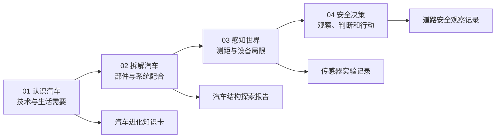

# 01–04 教学内容准备稿：小学五至六年级

这份内容包依据用户原课程建议和当前代码编写，供审阅、修改及后续接入。四章仍面向学生，沿用现有展厅和主要操作。当前交付的是内容准备稿：四份 JSON 尚未被产品导入，页面、原成绩和小游戏流程尚未因本内容包而改变。

## 阅读和修改入口

| 章节 | 内容文件 | 已准备的内容 | 学生能够说明的成果 |
| --- | --- | --- | --- |
| **01 认识汽车 / history** | [01-history.json](./01-history.json) | 5 张主题卡；5 事件排序；3 道技术匹配题；1 个未来选择与理由任务 | 一项汽车技术怎样回应生活需要 |
| **02 拆解汽车 / explore** | [02-explore.json](./02-explore.json) | 原 3 任务的功能复习；动力 4、结构 4、感知 5，共 13 项扩展识别任务；可选 4 步归位 | 一个部件的位置、功能和它与其他部件的关系 |
| **03 感知世界 / lidar** | [03-lidar.json](./03-lidar.json) | 原 8 部件与 4 步文案；20→60 米观察；3 轮距离挑战；正常/雨/雾对比；3 道局限题；6 张传感器卡 | 测距过程，以及一种传感器的作用和局限 |
| **04 安全决策 / traffic** | [04-traffic.json](./04-traffic.json) | 原 8 题的观察、选项反馈与复习；5 道新增情境题；观察→决策→反馈→总结草案 | 为什么一个行动能降低风险 |

JSON 内的 `studentCopy`、题目和解释是学生文案；`preparation`、`requirements`、`assetNeeds` 是维护与接入说明。后续页面只呈现学生需要的内容。

成果卡目前只定义字段。卡片页面、完成状态及保存功能仍需接入，准备稿没有建立跨章节存档。

## 教学定位

每个任务围绕一个核心问题，先观察或操作，再用一句话解释。第一次出现的“点云”“回波”“纳秒”等术语提供简短释义；测距实验只要求比较变化，不要求学生手算光速公式。

单选题包含选项、正确答案和纠错解释。开放表达鼓励说明理由，不把观点设成唯一答案，也不自动评判理由质量。01 的理由暂定 10–120 字，去除首尾空白后计数；这个长度是交互约束，不能充当学习质量评分。

原文建议四章分别约 10、15、10、15 分钟，合计约 50 分钟，可作为教师安排活动的参考。实际时间尚未经过课堂试用；13 项识别和全部新挑战可以分课完成，页面不强制倒计时。

推荐先在原流程补引导和复习，再逐章加入独立挑战。直接替换整套课程会同时影响熟悉的操作、题目和节奏；把研发档案、门禁及 100 分制一并加入还涉及跨章节规则。本批准备集中于 01–04 的内容，不把旧方案中的这些扩展视作已经确定的实现要求。

## 第一批：先接入原流程的引导与复习

这批优先使用已有资源，但知识卡、问答卡和复习入口仍需要界面与状态接入，不是把 JSON 放进目录就自动生效。

### 01：从展品中找生活问题

- 保留现有 14 件展品、年份定位和图片来源。
- 加入 5 张补充主题卡，解释动力、生产、新能源、感知与未来需要。
- 使用章首引导和通往 02 的过渡文案：“汽车能跑起来，还不够。下一站，看看它的动力、结构和感知设备怎样配合。”
- 先以阅读形式引导学生说出“这项变化帮助了谁、解决什么问题”。排序和理由输入留到第二批。

现有馆藏以中国新能源及智能化发展为主；“汽车诞生、汽车普及”在本稿中属于补充主题，不能让五张年代练习卡冒充完整世界汽车史。年代和图片沿用现有资料，本轮没有独立重新考证全部外部史料。

### 02：找到部件后，解释它负责什么

- 保留原 `BatteryPack → ADAS → Cabin` 三步拆解任务。
- 三任务完成后提供功能复习：电池储能、感知信息需要计算与行动配合、座舱帮助人与车交流。
- 电池复习通过 `questionRef` 引用扩展任务中的同一道题，后续只维护一份答案。
- 接入时修正动力故事的感知解释：摄像头接收道路图像，雷达和激光雷达主动探测。

原爆炸图、分类、聚焦、开合和灯光继续用于自由观察。新增问答可独立打开和关闭，完成后的复习不接管原三任务的完成判定。

### 03：比较 20 米和 60 米

- 保留原 8 部件、装配/爆炸/剖切三模式和四步原理演示。
- 沿用当前 5–80 米距离滑块，让学生先观察 20 米，再观察 60 米。
- 对应光往返时间约为 133.4 ns、400.3 ns；引导问题是“目标更远时，往返时间怎样变化？”
- 接入 6 张传感器卡，区分接收图像、测距离、近处探测和卫星定位。

当前点云是 720 点教学示意，四类道路目标及目标识别尚未实现。界面不能把示意动画标成真实环境测量或实际识别结果。

### 04：跑完原八题，再回看理由

- 保留红灯、行人、黄灯、学校、绿灯与行人、排队、施工、救护车八场景及原 8 分结果。
- 为每题准备观察线索、三项选择的解释、知识小结和一个讨论问题。
- 第一批建议在全程结束后打开复习卡，避免让新增长文依赖原 2300 ms 自动继续时间。
- 原八题解释通过 `sourceScenarioId`、`sourceChoiceId` 对照原数据；本稿不复制第二套原题答案。

例：学校路段复习问“开到 30 km/h 就能保证安全吗？”解释最高限速不是必须达到的速度，还要看孩子、视线和天气。

## 第二批：逐章接入新挑战

| 章节 | 新增玩法 | 接入前要解决的事项 |
| --- | --- | --- |
| **01** | 五事件排序、三题技术匹配、未来选择和理由、章内知识卡 | 排序提供拖动和“选卡片→选位置”两种方法；理由安全显示为文本；事件由稳定 ID 关联展品 |
| **02** | 三组共 13 项识别与功能问答；可选四步归位 | 子节点拾取与命中优先级；挑战时隐藏答案名称；底盘组合判定；毫米波雷达示意热点；分组归位动画 |
| **03** | 汽车/行人/树/路障目标；三轮远近挑战；雨雾对比和局限题；实验记录 | 同一份米制模型驱动画面与答案；提交前不显示精确距离；新目标与天气表现；定性效果明确为教学示意 |
| **04** | 绿灯无冲突、突然横穿、前方障碍、暴雨、感知不可靠五题；四步流程 | 场景条件与动画一致；新道具、停点和提示；学生读完反馈后自主继续；掌握反馈与原 8 分结果区分 |

03 当前准备的是三个固定教学轮次，第一轮为 A=5 米、B=12 米、C=20 米。三轮目标都使用独立 ID；画面上仍可显示 A/B/C。距离档为 `[0,10)`、`[10,20)`、`[20,40]`，10 米归第二档，20 米归第三档。随机位置与连续奖励需要另行定义生成、重试和奖励规则。

02 的 13 项是识别任务数量，包含从动力与轮胎作用两个角度重复观察车轮。底盘是组合系统任务：至少命中一处前/后悬架和制动系统，不能靠点两处悬架就过关。归位顺序用于教学演示，不代表工厂真实装配顺序。

04 每道新增题都写明场景条件。例如“突然横穿”给定车辆具备停车条件，不假定旁边车道可绕行；“障碍物”明确邻道安全未知。答案解释必须跟随这些条件，不能概括成任何情境都采用同一个动作。

原建议的 10/15 分、100 分、首答保留与重试奖励尚未启用。新增练习先呈现纠错和完成反馈；要合并成绩，需先确定统一规则。将四步流程改用到原八题，还涉及自动继续、过街反馈和暂停状态，需作为单独改动验收。

## 四章接入位置与维护方式

当前内容包独立放在 `docs/content/`。后续确认内容后，转为各章有类型的 `learning-data.ts`；不把所有题目塞进入口文件。

| 章节 | 现有代码位置 | 后续新增文件建议 | 责任边界 |
| --- | --- | --- | --- |
| **01** | [data.ts](../../../src/chapters/history/data.ts)、[render.ts](../../../src/chapters/history/render.ts)、[view.ts](../../../src/chapters/history/view.ts)、[controller.ts](../../../src/chapters/history/controller.ts) | `src/chapters/history/learning-data.ts`（未创建） | 展品资料与教学题分开；显示层呈现题目；控制层处理提交与重试 |
| **02** | [data.ts](../../../src/chapters/explore/data.ts)、[mission-state.ts](../../../src/chapters/explore/mission-state.ts)、[mission.ts](../../../src/chapters/explore/mission.ts)、[vehicle-rig.ts](../../../src/chapters/explore/vehicle-rig.ts)、[controller.ts](../../../src/chapters/explore/controller.ts) | `src/chapters/explore/learning-data.ts`、`learning-targets.ts`（均未创建） | 教学文案与模型目标映射分开；命中规则独立判断；模型层只处理可视化与拾取 |
| **03** | [data.ts](../../../src/chapters/lidar/data.ts)、[measurement.ts](../../../src/chapters/lidar/measurement.ts)、[experiment-state.ts](../../../src/chapters/lidar/experiment-state.ts)、[scan-scene.ts](../../../src/chapters/lidar/scan-scene.ts)、[scan-animation.ts](../../../src/chapters/lidar/scan-animation.ts)、[controller.ts](../../../src/chapters/lidar/controller.ts) | `src/chapters/lidar/learning-data.ts`（未创建） | 题目与环境说明是内容；距离计算保持纯函数；动画读取实验状态 |
| **04** | [data.ts](../../../src/chapters/traffic/data.ts)、[rules.ts](../../../src/chapters/traffic/rules.ts)、[simulation.ts](../../../src/chapters/traffic/simulation.ts)、[scenario-scene.ts](../../../src/chapters/traffic/scenario-scene.ts)、[presentation.ts](../../../src/chapters/traffic/presentation.ts)、[controller.ts](../../../src/chapters/traffic/controller.ts) | `src/chapters/traffic/learning-data.ts`（未创建） | 原题答案仍由原数据维护；复习用 ID 引用；规则、模拟、场景和反馈各自负责 |

后续改引导词，修改 `studentCopy`；改题干与选项，修改题目对象；改部件命中，修改 02 的目标映射；改距离挑战，修改 03 轮次与判定；改道路题先核对 04 的场景假设与场景配置。题目增加时新增稳定 ID，文案修改时保留 ID。新内容继续归属所在章节，学生页面只出现课程与活动。

## 模型、素材与科学表述

- 已有车辆模型：[yaojing-s9-optimized.glb](../../../public/assets/yaojing-s9-optimized.glb)。电机、传动、摄像头、激光与超声目标按真实命名节点关联。当前拾取最终提升为 `EV_SUV` 顶层装配，子节点存在不等于已能作为独立小游戏目标。
- 模型中未找到独立命名的毫米波雷达节点，02 将它列为待新增 `teaching-millimeter-radar` 教学热点；应明确标注示意，不据此宣称真实车型配置。
- 03 雨雾效果只用于定性对比，不给出虚构的车型识别率、固定退化比例或真实制动性能。
- 摄像头接收图像；激光雷达和毫米波雷达主动探测；GNSS 接收卫星信号帮助定位，不能靠定位识别行人。
- 多传感器可以补充信息，设备数量不能保证绝对安全。纯电动车行驶无尾气，也不能概括为全生命周期没有环境影响。
- 01 未来任务本批沿用现有未来展品与文字；新增图片或模型需记录来源、许可与示意属性。现有资源许可见 [THIRD_PARTY_NOTICES.md](../../../THIRD_PARTY_NOTICES.md)。

## 接入验收清单

- [ ] 五六年级学生能从题面理解任务；必要术语有释义，说明不依赖教师解释隐藏条件。
- [ ] 原导航、自由观察、原三任务、雷达原理演示、道路原八题可完整使用。
- [ ] 所有题目定义 ID 唯一；引用能定位；正确选项存在；修改选项顺序后仍按 ID 判定。
- [ ] 排序与选择支持触屏、鼠标和键盘；新增反馈可读完后继续，焦点位置清楚。
- [ ] 01 开放理由以文本展示，不执行 HTML；长度只判完成条件，不自动评观点。
- [ ] 02 子节点、组合任务、示意热点命中可分别验证；挑战不提前暴露名称答案。
- [ ] 03 画面、测距与答案读取同一模型；答案提交前隐藏；区间边界无重叠与缺口。
- [ ] 04 动画、选择解释与给定道路条件相符；扩展完成情况与原成绩标识清楚。
- [ ] 模型失败时仍可阅读题目和知识卡；持续显示必要的示意提示；重进章节没有遗留事件、计时或重复提交。

## 准备稿校验与来源

文档数据与源码关联校验记录见 [VALIDATION.md](./VALIDATION.md)。它覆盖 JSON、ID、答案、距离与原资料映射；新交互的可用性要在真正接入页面后另行验证。

来源是用户提供的“4 个展厅改造成闯关式学习路线”文本，以及 2026-11-08 工作区源码。原文中的独立数字、网站名与空行未当作素材。早期方案 [学习路线设计](../../superpowers/specs/2026-11-08-futuredrive-learning-route-design.md) 和 [旧实施计划](../../superpowers/plans/2026-11-08-futuredrive-plan.md) 仅作历史参考；其中扩展章节、门禁与计分安排不覆盖本稿。
