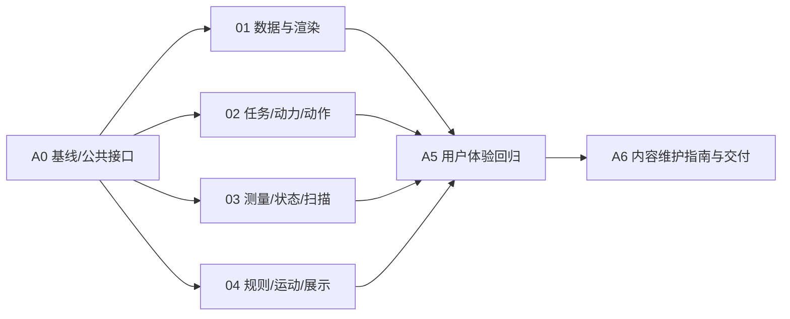

# 01–04 保持用户体验的内部结构整理 Plan

> **For agentic workers:** Use superpowers:subagent-driven-development（按章协作）或superpowers:executing-plans（单负责人执行）。只执行本文件A0、四章子计划、A5和A6；复选框仅在实际实现与验证后更新。

**Goal:** 保留最终用户现有页面与玩法，整理01–04内部代码，使资料、题目、实验和小游戏规则更容易定位、修改与验证。

**Architecture:** 保留app/chapters/shared；各章分离内容、纯规则/状态、界面与三维表现，controller负责连接。公共生命周期和装载接口保持现状，内容维护说明写在仓库开发文档中。

**Tech Stack:** TypeScript、Vite 6、Three.js 0.180、原生DOM、Vitest 4.1.12、Playwright 1.56.1；不新增依赖或服务。

**Spec:** [01–04内部整理设计](C:/Codex/citygame01/docs/superpowers/specs/2026-11-08-domain-learning-expansion-design.md)。

## Global Constraints

- 用户最新确认：保留现有用户体验，只整理内部代码，让内容和小游戏更容易修改。
- 实施以当前工作文件和本轮源码快照为基线，保留已有未提交代码、资源与许可；执行记录见docs/engineering/domain-expansion-progress.md。
- 页面排版、菜单、按钮、文案、操作、hash、计分和动画节奏保持原样；开发说明留在源码与文档中。
- 保留01的14展品、02的BatteryPack→ADAS→Cabin三任务、03的8部件/4步/5–80m/720点、04的原8情境和8分。
- 不执行旧学习底座、新课程、门禁、05/06、设计/报告存储和带版本路由；不把8分课程替换为100分。
- 公共mount(host)、load(host, signal?)、setActive/dispose与旧入口兼容不变；不预建ChapterContext或未来服务。
- 内容和纯规则不导入DOM/Three；场景及UI消费业务状态，计分/任务进度保持单一来源。
- 保留host隔离、scope清理、可暂停计时器、取消/迟到资源释放、重试和WebGL恢复。
- 不引入新框架、空模块或通用游戏引擎；章节样式位置和styles.css导入顺序保持不变。
- tests/unit/**与tests/e2e/**沿用现有配置和npm scripts；不自动提交或推送。

## Review Focus

1. 改资料/题目时遗漏图片、任务target或场景ID关联；H1、X1、L1、R1与A6负责。
2. 重复拾取/答题、手动/定时继续竞态推进两次；X1、R1/R3负责。
3. 02离开结束动力故事、03重置保留距离、03/04后台计时被统一语义改变；X2、L1/L3、R2/R3负责。
4. 提取规则导致画面、按钮、文案或CSS覆盖变化；各章浏览器验收与A5负责。
5. 模型失败、迟到请求、切章/重建遗留资源或重复事件；各章回归与A5保留原故障测试。

## 1. 执行顺序与协作

| 工作包 | 负责人 | 交付 | 依赖 |
| --- | --- | --- | --- |
| A0 基线与边界 | 集成负责人 | 固定现有体验、接口和验证基线 | 当前源码 |
| A01 历史 | 01负责人 | 数据、HTML渲染、交互职责明确 | A0 |
| A02 结构 | 02负责人 | 三任务、动力流程、模型动作独立 | A0 |
| A03 雷达 | 03负责人 | 测量、实验状态、扫描与输入独立 | A0 |
| A04 道路 | 04负责人 | 答题计分、流程、运动与展示独立 | A0 |
| A5 完整回归 | 集成负责人及四章负责人 | 四章原体验与资源恢复一致 | A01–A04 |
| A6 维护指南 | 集成负责人 | 内容修改地图、接口和验证记录 | A5 |



四个并发槽位包含集成负责人；最多同时运行三个章节子任务，空出后调度第四章。每章可以独立评审，公共文件由集成负责人维护。

## 2. 实施目标结构

以下职责文件已实施，验收与裁定见执行记录：

```text
src/
├── main.ts
├── app/                         # 保留注册、导航、运行时与公共外壳
├── chapters/
│   ├── history/                 # 01
│   │   ├── data.ts / view.ts
│   │   ├── render.ts            # 提取时间线与档案HTML
│   │   └── controller.ts
│   ├── explore/                 # 02
│   │   ├── data.ts / view.ts / mission.ts / focus.ts / scene.ts
│   │   ├── mission-state.ts     # 三任务推进
│   │   ├── powerflow-state.ts   # 动力流程状态
│   │   ├── vehicle-rig.ts / powerflow-scene.ts
│   │   └── controller.ts
│   ├── lidar/                   # 03
│   │   ├── data.ts / view.ts / model.ts / scene.ts
│   │   ├── measurement.ts / experiment-state.ts
│   │   ├── interaction.ts / model-rig.ts / scan-animation.ts
│   │   ├── concept.ts / scan-scene.ts
│   │   └── controller.ts
│   ├── traffic/                 # 04
│   │   ├── data.ts / view.ts / scene.ts / primitives.ts
│   │   ├── rules.ts / simulation.ts  # 04本地规则与原道路运动
│   │   ├── scenario-scene.ts / presentation.ts
│   │   └── controller.ts
│   └── driving/                 # 保留未注册的旧实现
├── shared/                      # 保留现有资源与生命周期工具
└── styles/、styles.css          # 保留顺序与视觉
docs/
├── development/                # 各章维护者文档，实施时创建
│   └── {history,explore,lidar,traffic}-content.md
└── engineering/
    ├── domain-expansion-progress.md # 实施时登记真实进度
    └── content-editing-guide.md     # 四章指南索引，集成负责人维护
```

只在当前功能有对应责任时创建文件；01没有测验，因此不建立空rules或计分模块。其他现有CSS与兼容入口继续保留。

## 3. 四章子计划与所有权

| 模块 | 独立计划 | 可编辑范围 |
| --- | --- | --- |
| 01 | [历史子计划](C:/Codex/citygame01/docs/superpowers/plans/2026-11-08-domain-01-history.md) | chapters/history、tests/unit/history、history独立E2E、history-content.md |
| 02 | [结构子计划](C:/Codex/citygame01/docs/superpowers/plans/2026-11-08-domain-02-explore.md) | chapters/explore、tests/unit/explore、explore独立E2E、explore-content.md |
| 03 | [雷达子计划](C:/Codex/citygame01/docs/superpowers/plans/2026-11-08-domain-03-lidar.md) | chapters/lidar、tests/unit/lidar、lidar独立E2E、lidar-content.md |
| 04 | [道路子计划](C:/Codex/citygame01/docs/superpowers/plans/2026-11-08-domain-04-traffic.md) | chapters/traffic、tests/unit/traffic、traffic独立E2E、traffic-content.md |

各章内容指南位于docs/development/。app、shared、公共types/config、根兼容入口和styles.css由集成负责人维护；只做有证据必要的接线修正。各章新增独立E2E和独立指南，避免同时编辑tests/e2e/chapters.spec.ts或公共文档索引。

## Task A0：冻结现有用户体验和接口

**Files:** Read src/app/{types,chapters,runtime,navigation}.ts、src/shared/lifecycle.ts、四章data/view/controller、tests/unit/*、tests/e2e/chapters.spec.ts；实施时创建docs/engineering/domain-expansion-progress.md。

**Interfaces:** mount(host: HTMLElement): ChapterController；load(host: HTMLElement, signal?: AbortSignal): Promise<ChapterController>；ChapterController提供setActive(active: boolean): void与dispose(): void。保持现有注册的四章和菜单行为。

- [x] 运行npm run check，重新确认23项单元、11项浏览器及构建基线；若失败，先定位并记录实际问题。
- [x] 记录四章ID/内容/操作/计分/时间参数、兼容入口、资源降级、03重置保留距离，以及当前CSS导入顺序。
- [x] 保留各章关键界面与流程的基线证据，登记公共接口和修改范围，开始四章独立拆分。

## Task A5：合入与最终用户体验回归

**Files:** tests/e2e/{history,explore,lidar,traffic}-domain.spec.ts，保留tests/e2e/chapters.spec.ts；规则/接口修正交对应章节负责人。

**Interfaces:** 消费四章原mount(host)与各子计划的纯状态接口；不新增页面、公共进度服务或导航参数。

- [x] 确认内容/纯状态可在Node测试中导入，不加载DOM/Three，任务/分数/实验进度没有UI或场景中的第二份来源。
- [x] 走完01年份定位、02三任务/动作/动力、03三模式/扫描/60m重置、04八题/8分结算；包括误选、重复操作、退出重开和原反馈节奏。
- [x] 比对基线中的版式、按钮、文案、菜单、hash与输入方式；保留旧入口、模型故障、迟到取消、后台暂停、上下文重建和资源释放验证。
- [x] 运行npm run check并记录通过项与失败项；出现体验变化先修复，不把它作为附带功能接受。

## Task A6：内容修改地图与交付

**Files:** Create docs/engineering/content-editing-guide.md；Update README.md、PROJECT_ARCHITECTURE.md、docs/engineering/domain-expansion-progress.md。

**Interfaces:** 文档只引用实施后的真实文件和导出，分别标明内容字段、规则/状态接口、场景关联和对应测试。

- [x] 汇总四章独立内容指南并建立索引，写清常见修改路径：01资料/图片/年份；02装配文案/分类/任务target/动力流程；03部件/步骤/测量参数/扫描效果；04题目/选项/反馈/场景ID/计分。
- [x] 用现有字段示例说明“只改文案”和“改模型或玩法”分别涉及哪些文件；不实际增加题目或功能，指南准确描述仍需跨层配合的情况。
- [x] 核对文档链接、npm命令及路径；PROJECT_ARCHITECTURE只展示已实现文件，未来示例单独标为参考。
- [x] 运行git diff --check，登记本轮实际实现和验证证据；交付四章内部整理，不自动继续旧扩展方案。

## 4. 后续参考与本轮边界

先前的学习底座、05设计、06仿真已移出当前执行范围，其文档保留历史参考状态。后续如果明确需要新增业务功能，再基于实际完成的结构制定对应任务；本轮不为它们增加页面、接口、服务或目录。

2026-11-08范围修订依据：用户明确“保留现有用户体验，整理内部代码，让内容和小游戏更容易修改”。本计划以该要求取代此前01–06扩展路线；已完成四章整理、独立审查与最终验收（98项单元、23项浏览器及生产构建通过）。
