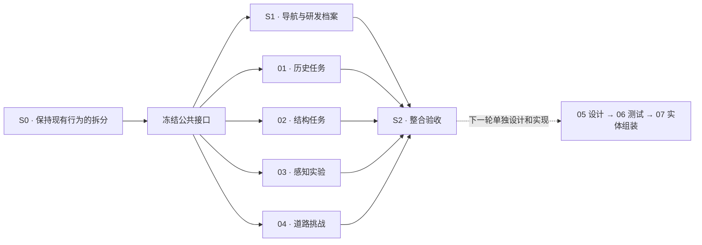

# FutureDrive Lab 01–04 修改实施 Plan

> **For agentic workers:** REQUIRED SUB-SKILL: Use superpowers:subagent-driven-development or superpowers:executing-plans to implement this plan task-by-task. Steps use checkbox (`- [ ]`) syntax for tracking. 本次只制定计划；执行时按以下公共与模块边界协作，不直接并行修改现有 main.ts。

**Goal:** 将 01–04 改造成连续闯关路线，产出统一研发档案，为后续 05/06 提供学习成果。

**Architecture:** 先保持现有行为地拆出章节模板与控制器，再建立导航、进度和报告接口。01–04 在独立目录开发，公共负责人负责跨模块接口和最终整合。

**Tech Stack:** 现有 Vite 6、TypeScript 5、Three.js 0.180、原生 DOM；localStorage；结构翻新已加入 Vitest 4.1.12 与 Playwright，后续复用验证基础。

**结构更新（2026-11-08）：** 01–04 目录、注册表、导航和受控生命周期已完成，实际文件地图见 [当前架构](C:/Codex/citygame01/PROJECT_ARCHITECTURE.md)。下文包含后续学习档案、解锁和教学任务的目标结构；这些功能尚未实施，S0 中与学习档案适配有关的内容仍需后续完成。

**Spec:** [学习路线设计稿](C:/Codex/citygame01/docs/superpowers/specs/2026-11-08-futuredrive-learning-route-design.md)。

## Global Constraints

- 保留原生 DOM 技术路线和现有图片、车辆、VLP16 资源及许可；本轮不开发后端、账号或 05–07 页面。
- 正式课程分母为 4；05–07 只能标记为后续阶段，不能导航到空页面。
- 首答计分、纠错后掌握；开放预测按有效提交给参与分，不能自动评价观点对错。
- 不完整或格式不合法的输入先阻止提交，不调用 recordAttempt；有效知识答案即使错误也必须保存首答。
- 学习模式限制顺序，浏览模式允许查看但不写正式成绩或解锁。
- localStorage 键 `futuredrive.learning.v1`，`schemaVersion: 1`，`courseVersion: '01-04-v1'`。
- 输入小组名和理由只作为文本渲染；模型缺失与存储失败有可继续的反馈。
- 进入/离开/销毁使用统一生命周期；计时器与渲染循环都要受控。
- 保留当前未提交改动；搬迁以当前工作区为基线，不从旧提交覆盖现有内容。

## Review Focus

1. 未完成 01 直接访问 #traffic、hash 变化或浏览器前进后退：学习模式仍执行统一进入检查。测试归属 S1。
2. localStorage 损坏、版本不支持、拒绝写入：恢复有效默认档案或内存模式，不能白屏。测试归属 S1。
3. 重复提交、纠错、刷新：首答分数只能记录一次，掌握可提升，浏览模式不写正式记录。测试归属 S1 和各模块末项。
4. 3D 模型缺少命名部件、错误选项或天气退化：模块能解释原因，示意不能伪装成真实能力。测试归属 02、03、04。
5. 答题/扫描/动画中切页再返回：不跳关、不补跑隐藏期间计时、不新增循环。测试归属 S0、各模块与 S2。

## 1. 计划包与负责人

| 工作包 | 负责人职责 | 独立计划 | 依赖 |
|---|---|---|---|
| S0 公共拆分 | 页面搬迁、控制器适配、测试基础 | 本文件 Task S0 | 无 |
| S1 公共学习底座 | 导航、登记表、档案、总进度、报告 | 本文件 Task S1 | S0 |
| 01 history | 历史三任务、知识卡 | [01 计划](C:/Codex/citygame01/docs/superpowers/plans/2026-11-08-futuredrive-01-history.md) | S0；按 S1 冻结接口开发 |
| 02 explore | 三组部件任务、结构报告、引导组装 | [02 计划](C:/Codex/citygame01/docs/superpowers/plans/2026-11-08-futuredrive-02-explore.md) | S0；按 S1 冻结接口开发 |
| 03 lidar | 三实验、测距挑战、传感器记录 | [03 计划](C:/Codex/citygame01/docs/superpowers/plans/2026-11-08-futuredrive-03-lidar.md) | S0；按 S1 冻结接口开发 |
| 04 traffic | 八关、四步交互、首答计分 | [04 计划](C:/Codex/citygame01/docs/superpowers/plans/2026-11-08-futuredrive-04-traffic.md) | S0；按 S1 冻结接口开发 |
| S2 整合 | 接通实际存储与解锁、全流程验收 | 本文件 Task S2 | S1 + 01–04 |



执行时可同时运行的工作包数量由实际协作槽位决定，不要求五个负责人同时在线；核心是互不修改对方拥有的文件。模块可用 S0 提供的内存档案适配器自测，S2 切换到 S1 的真实存储。

## 2. 目标文件结构和所有权

以下路径均相对于 `C:/Codex/citygame01`；标注的文件都是计划中的目标，当前尚未创建。

```text
src/main.ts                         公共负责人：启动、注册、挂载
src/styles.css                      公共负责人：现有样式基线与全局主题
src/app/chapters.ts                  公共负责人：四章注册、七阶段路线元信息
src/app/navigation.ts               公共负责人：地址、解锁、显示与生命周期
src/learning/types.ts                公共负责人：下面约定的类型
src/learning/course.ts               公共负责人：纯数据的阶段与必做/可选任务元信息
src/learning/progress-store.ts       公共负责人：正式档案与存储
src/learning/memory-store.ts         公共负责人：同接口的模块开发适配器
src/learning/route-view.ts           公共负责人：总进度与成果列表
src/learning/learning.css            公共负责人：公共学习界面
src/shared/sensors.ts                公共负责人：SensorId 与基础卡片定义
src/shared/driving.ts                公共负责人：DrivingAction 基础类型
src/chapters/history/                01 负责人：data、view、rules、index、chapter.css
src/chapters/explore/                02 负责人：model-explorer、targets、tasks、view、index、chapter.css
src/chapters/lidar/                  03 负责人：lidar-explorer、experiments、data、view、index、chapter.css
src/chapters/traffic/                04 负责人：traffic-scene、scenarios、decision、view、index、chapter.css
tests/learning/                     公共负责人：档案和导航纯逻辑测试
tests/chapters/history/             01 负责人测试
tests/chapters/explore/             02 负责人测试
tests/chapters/lidar/               03 负责人测试
tests/chapters/traffic/             04 负责人测试
src/game.ts                        保留独立驾驶游戏，本轮不重新接入
```

所有模块只查询自己的 `host`。保留旧 styles.css 的视觉规则作为搬迁基线，新任务界面写各模块的 chapter.css；公共负责人统一 import 顺序。模块不得为覆盖公共样式加入无范围的 `button`、`canvas` 或 `body` 规则。course.ts 只导出阶段和任务元数据，存储层读取它而不导入 UI；app/chapters.ts 将该元数据与模块 render/setup 关联，避免状态测试间接加载 Three.js 页面。

## 3. S0 冻结的公共接口

在 `src/learning/types.ts` 定义并导出下列类型；下面是接口约定，不是本次要写入运行代码的实现：

```ts
type ChapterId = 'history' | 'explore' | 'lidar' | 'traffic';
type LearningMode = 'learn' | 'browse';
type JsonValue = null | boolean | number | string | JsonValue[]
  | { [key: string]: JsonValue };

interface TaskAssessment { correct: boolean; score: number; maxScore: number }
interface TaskAttemptInput extends TaskAssessment {
  chapterId: ChapterId;
  taskId: string;
  answer: JsonValue;
  evidence: Record<string, JsonValue>;
}
interface TaskProgress {
  taskId: string;
  attemptCount: number;
  firstScore: number;
  firstAnswer: JsonValue;
  firstCorrect: boolean;
  maxScore: number;
  mastered: boolean;
  latestAnswer: JsonValue;
  latestCorrect: boolean;
  latestEvidence: Record<string, JsonValue>;
  updatedAt: string;
}
interface ChapterResult {
  chapterId: ChapterId;
  title: string;
  score: number;
  maxScore: number;
  summary: string[];
  artifact: JsonValue;
  completedAt: string;
}
interface LearningProfile {
  schemaVersion: 1;
  courseVersion: '01-04-v1';
  groupName: string;
  tasks: Partial<Record<ChapterId, Record<string, TaskProgress>>>;
  results: Partial<Record<ChapterId, ChapterResult>>;
}
interface LearningStore {
  getSnapshot(): LearningProfile;
  recordAttempt(attempt: TaskAttemptInput): void;
  markTaskMastered(chapterId: ChapterId, taskId: string,
    evidence: Record<string, JsonValue>): void;
  completeChapter(result: ChapterResult): void;
  subscribe(listener: (profile: LearningProfile) => void): () => void;
  setGroupName(name: string): void;
  resetProfile(): void;
}
interface ChapterContext {
  progress: LearningStore;
  navigate(chapter: ChapterId): boolean;
  getMode(): LearningMode;
}
interface ChapterController {
  setActive(active: boolean): void;
  dispose(): void;
}
```

- 每个模块导出 `renderHistoryChapter()` / `renderExploreChapter()` / `renderLidarChapter()` / `renderTrafficChapter(): string`，以及 `setupHistoryChapter(host, ctx)` / `setupExploreChapter(host, ctx)` / `setupLidarChapter(host, ctx)` / `setupTrafficChapter(host, ctx): ChapterController`。
- 正式 `recordAttempt` 首次保存 firstScore/firstAnswer/firstCorrect，后续不覆盖；每次真正作答才递增 attemptCount，更新 latestAnswer/latestCorrect。它不自动完成任务；模块在答案正确且活动全部完成后调用 `markTaskMastered`，该方法检查最近答案正确，只允许 mastered 从 false 变 true，不增加作答次数。
- 浏览模式用正式快照的副本创建内存档案，ctx 不引用正式可写 store；切换学习/浏览模式时先 dispose 原控制器，再用对应 store 创建 ctx 和模块控制器，避免临时练习写回正式档案。
- `completeChapter` 校验登记表中的全部必做 taskId 已 mastered 才写成果；重复调用不重复授章，不替换首答分数。无数值成绩的 02/03 报告填 `score: 0, maxScore: 0`，公共 UI 显示“完成/掌握”，不得显示 `0/0`。
- `getSnapshot` 返回不可由调用方修改内部状态的快照。小组名去首尾空白后 1–20 字，默认“我的研发小组”。
- `SensorId` 在 sensors.ts 定义为 `camera-front | camera-surround | lidar | radar | ultrasonic | gnss`；03 的卡片和 02 的目标使用它。
- `DrivingAction` 在 driving.ts 定义为 `stop | proceed-cautiously | yield | emergency-stop | slow-pass | slow-stop | slow-keep-gap | safe-stop-alert`；04 成果中的规则建议保留这些 ID，供以后 05 读取。

## Task S0：拆出可以独立协作的章节基线

**Files:** Modify [main.ts](C:/Codex/citygame01/src/main.ts)、[styles.css](C:/Codex/citygame01/src/styles.css)、[package.json](C:/Codex/citygame01/package.json)；Create 上述章节目录中的 view/index、02 model-explorer、03 lidar-explorer、04 traffic-scene、learning/types、learning/course、memory-store、vitest.config.ts；迁移后删除重复的根目录 lidar-explorer.ts/traffic-chapter.ts，保持 game.ts。

**Interfaces:** Produces 本节四组 render/setup、ChapterController、LearningStore、`createMemoryLearningStore(initial?: LearningProfile): LearningStore`；S0 的 ctx.navigate 接原导航，档案先用内存适配器。Consumes 现有模板、当前工作区的场景实现和素材。

- [ ] 记录四页和模型交互基线：菜单、直接打开、年份跳转、车门/尾门/灯光、三步拆解、LiDAR 各视图和八情境；核对现有改动，确认迁移基线。
- [ ] 配置 Vitest 3.x 的兼容开发依赖、vitest.config.ts 与 `test: vitest run`、`test:watch: vitest` 脚本；先写 `tests/learning/memory-store.test.ts`：首次记录后重试不覆盖 firstScore/firstAnswer，正确作答未显式掌握前不完成，markTaskMastered 不增加次数，快照不可反向改内部数据。
- [ ] 运行 `npm.cmd run test -- tests/learning/memory-store.test.ts`，验证失败来自尚未实现的接口，而非缺少 test 脚本。定义冻结类型及内存适配器，测试绿后移动模板和场景，所有选择器改为 host 范围。
- [ ] 适配场景控制器：02/03 去除无条件循环；04 暂停答题延时与行人过街推进。暂停保留逻辑进度，恢复从剩余时长继续，dispose 清理监听/计时器/观察器/WebGL 资源。
- [ ] `npm.cmd run test` 与 `npm.cmd run build` 通过；浏览器复核基线以及 inactive→active→dispose，不出现第二个渲染循环。
- [ ] 仅提交 S0 自己的变更；冻结接口与目录所有权，之后才交给模块负责人。

S0 的 course.ts 按四份模块计划登记 01 的 3 个、02 的 13 个、03 的 5 个、04 的 8 个必做 taskId，以及 02 的 1 个可选组装 ID。原展示尚未接通新任务时导航维持可浏览；S1 再启用正式学习门禁。

## Task S1：正式研发档案、总进度与统一导航

**Files:** Create app/chapters.ts、app/navigation.ts、learning/progress-store.ts、learning/route-view.ts、learning/learning.css、shared/sensors.ts、shared/driving.ts、tests/learning/progress-store.test.ts、tests/learning/navigation.test.ts；Modify main.ts 与需要的全局标题/导航样式。

**Interfaces:** Consumes S0；Produces `createLearningStore(storage: Pick<Storage, 'getItem' | 'setItem' | 'removeItem'> | null): LearningStore`、`canEnterChapter(profile: LearningProfile, chapterId: ChapterId, mode: LearningMode): boolean`、`resolveInitialChapter(hash: string, profile: LearningProfile, mode: LearningMode): ChapterId`；登记表包含 requiredTaskIds、optionalTaskIds 与各章 render/setup。

- [ ] 写上述测试并先红：锁定直达回退，未知 hash 回 history；完整档案可进入后章；重试不刷分；正确作答未总结不掌握，markTaskMastered 不增作答次数；缺必做任务不能 completeChapter；损坏 JSON、未知版本、非法分数、存储抛错都不白屏；浏览模式不改变正式快照。
- [ ] 实现版本化存储及校验，只接受当前课程登记过的必做/可选 chapter/task ID；结果不能声称未掌握任务已完成。已保存任务恢复后重新校验解锁；写入失败保留内存结果并显示保存状态。
- [ ] 统一菜单、data-next、首次 hash、hashchange 和 popstate 的进入检查；不要同时保留旧 showPage 各自改变地址。应用内切页采用 pushState，首次纠正/回退采用 replaceState，浏览器后退不再 push 新记录。
- [ ] 做四章进度、小组名输入、成果列表和“新建档案”确认；保留 05–07 的明确未开放标记，无数值报告显示完成状态。
- [ ] 编写组名 `` 按文本显示的浏览器验收；测正式/浏览模式、清空确认取消、拒绝存储后的继续学习。
- [ ] 运行 `npm.cmd run test -- tests/learning` 和 `npm.cmd run build`；提交公共变更，发布实际适配器给四章负责人。

## Task S2：串联四章并交付修改结果

**Files:** Modify main.ts、app/chapters.ts、PROJECT_ARCHITECTURE.md、全局导航与公共成果视图；模块内部修正交回各自负责人处理。

**Interfaces:** Consumes 四章控制器和 ChapterResult；Produces 01–04 完整学习流程。未来阶段只读当前成果字段，不在本任务实现 05/06。

- [ ] 按四份计划接入模块与所有必做 ID；检查模块输出类型、score/maxScore、completedAt 和 SensorId/DrivingAction 完全一致。
- [ ] 用新正式档案走完 01→02→03→04，每章包含一次错答或误点、纠正、成果生成和下一章解锁；同时确认首答成绩不被纠正覆盖。
- [ ] 在扫描、行人动画和结果反馈期间切页/刷新/复习，检查暂停、已提交记录恢复、无重复得分；档案重复提交与损坏恢复也完整走一次。
- [ ] 桌面和手机各完成 01 卡片、02 点选、03 距离挑战、04 全流程；核对界面焦点、反馈、教学示意、成果内容。
- [ ] 执行 `npm.cmd run test`、`npm.cmd run build`；按新的目录与实际行为更新 PROJECT_ARCHITECTURE.md。
- [ ] 整理交付说明：完成内容、保留资源、测试证据、未来 05/06 的接口和后续开发边界；仅在本轮全部验收后报告实施完成。

## 4. 分阶段发布与后续路线

| 阶段 | 可验收结果 |
|---|---|
| P0 / S0 | 拆分后的原有四展厅可运行，模块拥有独立编辑范围 |
| P1 / S1 + 四章必做任务 | 连续学习、纠错、档案与四份成果打通 |
| P2 / 各章增强 + S2 | 02 引导组装、反馈打磨、触屏与生命周期完整验收 |
| 后续独立版本 | 05 配置工坊，再做读取配置的 06 2D 测试场，最后衔接 07 实体任务 |

本计划不提供未经工作量验证的开发天数。下一次进入实施时，先执行 S0，再按文件所有权安排 01–04 协作；不能直接把旧 main.ts 分给四个人同时修改。
