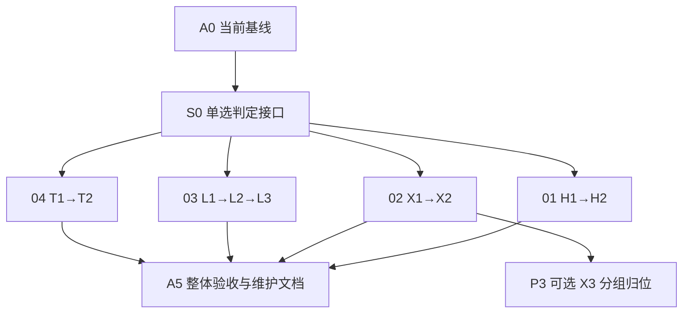

# 01–04 闯关式学习内容 Implementation Plan

> **For agentic workers:** REQUIRED SUB-SKILL: Use superpowers:subagent-driven-development or superpowers:executing-plans to implement this plan task-by-task. 推荐按章拆分任务与评审；具体执行方式由用户启动实施时确定。Steps use checkbox (`- [ ]`) syntax for tracking.

**Goal:** 面向小学五至六年级，在现有 01–04 展厅中加入引导、挑战、纠错解释与学习成果，使学生能够理解并说明操作背后的原因。

**Architecture:** 复用当前 app/chapters/shared 结构，原控制器与玩法保留；各章新增 learning-data、必要的纯状态与表现文件。四章共用一个小型纯单选判定模块；模型命中、实验测距、道路阶段均由各章规则维护。

**Tech Stack:** TypeScript、Vite 6、Three.js 0.180、原生 DOM、Vitest 4.1.12、Playwright 1.56.1；本期不新增依赖。

**Spec:** [01–04 闯关式学习内容设计](../specs/2026-11-08-upper-primary-learning-design.md)。

**Status:** 2026-11-08 已按 01–04 并行实施并逐章保存 Git，包含 02 分组归位。最终完整检查通过：191 单元、构建、69 浏览器，最终复审 APPROVE。实际证据与提交见 [实施记录](../../engineering/upper-primary-learning-progress.md)。

## Global Constraints

- 面向小学五至六年级；每个任务一个核心问题；必要术语有一句解释。
- 章节 ID 保持 `history/explore/lidar/traffic`，编号保持 `01/02/03/04`；现有导航与 hash 保持兼容。
- 保留现有 14 展品、原 `BatteryPack→ADAS→Cabin` 三任务、雷达 8 部件/4 步/5–80 米/720 点示意、道路原 8 情境与 8 分结果。
- 保留旧流程的 02 五秒动力故事、03 每步 1.3 秒、04 的 2300 ms 反馈/4.8 秒过街/550 ms 过街后反馈和后台暂停语义。
- 新增反馈由学生读完后主动继续；新任务重置与原玩法重置分别处理。
- 内容与纯规则不导入 DOM/Three.js；控制器连接状态、界面与场景，不另外维护分数或完成状态副本。
- 不新增框架、后端、登录、云存档、依赖或通用游戏引擎；沿用 TypeScript、Vite 6、Three.js 0.180、Vitest 4.1.12、Playwright 1.56.1。
- `mount(host)`、`load(host, signal?)`、`setActive/dispose` 保持兼容；使用现有 scope、暂停计时与资源释放工具。
- 所有选择按稳定 ID 判断；未知 ID 不改变状态；答案顺序变化不改变正确性。
- 触屏、鼠标和键盘都能完成任务；输入文本按文本显示；不以拖动为唯一操作。
- 成果保存在当前已挂载控制器的内存中；普通切章保留，刷新、控制器重建或页面退出后重置。本期不承诺持久保存。
- 原 8 分与扩展完成反馈分开展示；本期不加入 100 分、首答计分、连续奖励和章节门禁。
- 学生界面只出现学习内容、操作与必要示意说明；开发说明留仓库。
- 开工前保存已有非忽略代码与资源；完成一章后由集成负责人单独暂存、验证和本地提交。章节代理不操作 Git 索引；不推送、安装或发布。

## Review Focus

1. 触屏/键盘无法完成排序和三维目标选择：H2/X2/L2 的替代操作与浏览器测试负责。
2. 重复提交或继续跳过未完成题：S0、H2、X2、L2、T2 的纯状态测试负责。
3. 新模式退出后遗留镜头、模型位置、计时或事件：X3、T2 和 A5 的切换/清理测试负责。
4. 距离缩放、10/20 米边界或提前显示答案造成误判：L2 的米制数据与浏览器断言负责。
5. 模型失败、控制器重建或文本输入导致记录虚假/脚本执行：H2/X2 的降级与文本测试、A5 的故障回归负责。

## 1. 内容清单与材料取舍

| 章节 | P1 引导与复习 | P2 新挑战 | 学习成果 |
| --- | --- | --- | --- |
| **01** | 5 张主题卡与展品引导 | 5 事件排序、3 题技术匹配、未来选择与 10–120 字理由 | 汽车进化知识卡 |
| **02** | 原三步后 3 题功能复习、感知文案修正 | 动力 4/结构 4/感知 5，共 13 项 | 汽车结构探索报告 |
| **03** | 8 部件/4 步文案、20→60 米观察、6 张传感器卡 | 四目标、3 轮测距、正常/雨/雾、3 题局限 | 传感器实验记录 |
| **04** | 原八题结束后复习 | 5 个进阶情境，观察→决策→反馈→总结 | 道路安全观察记录 |

内容来源：[01](../../content/2026-11-08-upper-primary/01-history.json)、[02](../../content/2026-11-08-upper-primary/02-explore.json)、[03](../../content/2026-11-08-upper-primary/03-lidar.json)、[04](../../content/2026-11-08-upper-primary/04-traffic.json)。JSON 是准备稿；接入后以各章有类型的 learning-data.ts 为运行内容唯一来源，准备稿保留为参考，避免长期维护两套答案。

原文中的 05/06/07、七阶段解锁、100 分和随机连胜属于后续方向；本期不默认实施。02 重新组装是可选 P3，单独审阅。原文约 50 分钟为教学建议，未做课堂验证，不据此估算开发工作量。

## 2. 文件与责任边界

| 所有者 | 新建文件 | 修改现有文件 |
| --- | --- | --- |
| 集成 | `src/shared/learning-assessment.ts`；对应单元测试 | 根 README、PROJECT_ARCHITECTURE、内容维护索引；必要时公共接线 |
| 01 | `history/learning-data.ts`、`learning-state.ts`、`learning-view.ts` | history/controller、view、gallery.css；history 指南 |
| 02 | `explore/learning-data.ts`、`learning-targets.ts`、`learning-state.ts`、`learning-view.ts`、`camera-observation.ts`；本次包含 `assembly-state.ts` | explore/controller、data、styles、vehicle-rig；explore 指南 |
| 03 | `lidar/learning-data.ts`、`learning-measurement.ts`、`learning-state.ts`、`learning-world.ts`、`learning-view.ts`、`weather-state.ts`、`learning-camera.ts` | lidar/controller、data、view、styles；lidar 指南 |
| 04 | `traffic/learning-data.ts`、`learning-view.ts`、`practice-state.ts`、`practice-scene.ts` | traffic/controller、view、styles；traffic 指南 |

章内源码路径均以 `src/chapters/` 为前缀；精确测试与接口见各子计划。旧 data/rules/measurement/simulation 继续负责旧流程；新增文件只承担已有内容所需职责。S0 不建设注册表、事件总线或游戏框架。

## 3. 执行顺序与协作

用户已授权按章并行实施，各章内部按 P1→P2（02 包含 P3）顺序推进；图中的箭头表示依赖。01/02/03/04 使用独立文件和测试，分别实施和审阅。集成负责人负责公共文件及 Git，章节负责人只改所属章；四个并发槽位包括集成负责人，最多同时三个章节任务。

| 独立工作包 | 子计划 | 完成标志 |
| --- | --- | --- |
| **01 history** | [01 子计划](./2026-11-08-upper-primary-01-history.md) | 三任务与知识卡完整可用，14 展品可自由浏览 |
| **02 explore** | [02 子计划](./2026-11-08-upper-primary-02-explore.md) | 13 项与报告完整可用，原三任务不受影响 |
| **03 lidar** | [03 子计划](./2026-11-08-upper-primary-03-lidar.md) | 测距与天气实验完整可用，旧雷达保持原行为 |
| **04 traffic** | [04 子计划](./2026-11-08-upper-primary-04-traffic.md) | 原八题复习与进阶五题完整可用，成绩标识清楚 |

## Task A0：固定开工时的体验与资源基线

**Files:** Read `src/app/types.ts`、`src/app/runtime.ts`、四章 controller/data/view、`docs/engineering/domain-expansion-progress.md`；Create `docs/engineering/upper-primary-learning-progress.md`。

**Interfaces:** 原 `ChapterController.setActive(active: boolean): void` 与 `dispose(): void`；本任务不生产新运行接口。

- [x] 运行 `npm run check`，记录当时实际结果、工作区改动与四章截图；基线为 98 单元、构建、23 浏览器通过。自动服务收尾挂起后以独立预览取得浏览器退出 0，未隐藏测试失败。
- [x] 登记材料与内容包版本、原任务/题目/时间参数、模型节点和许可；确认没有新旧 Plan 同时安排重做内部拆分。
- [x] 在进度记录中登记 S0 与 H/X/L/T 的所有权和待验证项；只保存必要基线，不恢复旧快照覆盖当前文件。

## Task S0：共用纯单选判断

**Files:** Create `src/shared/learning-assessment.ts`、`tests/unit/learning-assessment.test.ts`。

**Interfaces:** Produces `ChoiceQuestion`（`id/prompt/choices[{id,label}]/correctChoiceId/correctFeedback/retryFeedback`）、`ChoiceVerdict = 'correct' | 'incorrect' | 'invalid'`，以及 `evaluateChoice(question: ChoiceQuestion, choiceId: string): ChoiceVerdict`。四章只消费该接口，提交/重试/完成规则仍在各章。

- [x] 写失败测试：对同一道题断言 `expect(evaluateChoice(q, q.correctChoiceId)).toBe('correct')`、错误选项为 `'incorrect'`、未知 ID 为 `'invalid'`，交换选项顺序后结果不变。
- [x] 运行 `npm run test:unit -- tests/unit/learning-assessment.test.ts`，确认接口未实现导致测试失败。
- [x] 实现上面的类型和函数；无 DOM/Three 依赖，不从按钮位置或 `data-correct` 判断。
- [x] 重跑同一命令，确认全部通过；按接口交付四章，记录结果并由集成负责人保存公共基础提交 `0b6fff7`。

## Task A5：联调、回归与维护交付

**Files:** Create `tests/e2e/learning-route.spec.ts`；Modify `docs/engineering/upper-primary-learning-progress.md`、`docs/engineering/content-editing-guide.md`、`PROJECT_ARCHITECTURE.md`、`README.md`。保持已有测试与兼容入口。

**Interfaces:** 消费四章原 mount/生命周期和各子计划产出的学习接口；不添加全局成绩服务或 ChapterContext。

- [x] 写路线测试：普通切章再返回保留未提交理由和任务结果；刷新后为新学习状态；原 04 分数不受进阶题影响；失败/重试不重复登记成果。
- [x] 构建后执行 `npm run test:e2e -- tests/e2e/learning-route.spec.ts`；11 个用例通过，对四章新入口分别验证 1440×900 和 390×844 布局，键盘、触屏、文字可读与焦点恢复。
- [x] 按四章子计划完成原玩法回归，保留已有模型失败、迟到加载、后台暂停、WebGL 恢复和资源清理测试；新动画退出后无残留。
- [x] 运行 `npm run check`，取得 191 单元、构建和 69 浏览器全部通过的完整结果（退出 0）；初次相机断言失败已定位并通过真实回归修正，未减少既有行为断言。
- [x] 更新真实架构、题目修改位置、内容唯一来源、成果生命周期和许可记录；本期包含四章 P1/P2 和 02 P3，最终整体验收仍以实际通过结果和提交为准。

## 4. 后续方向与本期接口关系

05 的车型、能源、预算和条件→动作卡；06 的感知、规则驱动结果和测试比较；07 的实体制作均需独立设计。将来若加入这些功能，再定义持久档案、VehicleDesign、Scenario 与测试报告接口；当前不创建空模块或把新增教学题挂到新编号。

## 5. 本 Plan 的审阅与执行状态

用户已授权执行四章并行实施、包含 02 分组归位，并在每章完成后保存本地 Git。独立实现、审查、浏览器验证和 Git 保存的实际状态分别记录在实施记录中；复选框表示验证过的任务，不代替提交 SHA。

本轮按 01–04 分开协作，公共接口、Git、构建与浏览器验收由集成负责人统一处理。受四个并发槽位限制，先派出 01/02/03，空出槽位后启动 04；四章代码、最终相机交接修正和完整验收均已完成，实际证据见实施记录。05/06 未纳入。

## 6. 计划自检记录

2026-11-08 编制计划时对设计稿、总 Plan 与四份子计划进行了自检：23 个链接及章节锚点有效，25 处现有文件路径存在；当时 19 个建议新增源码文件尚未创建，85 个实施/验收复选项未完成。内容包包含 26 道单选题，02 的 13 项、03 的 3 轮和 04 的原 8 题/新增 5 题与计划一致。这些是编制时记录，当前实现及验证以实施记录和已勾选项目为准。

已核对全局约束逐条覆盖、章节文件所有权、任务依赖、接口名称、重复操作与降级测试归属。该结果是计划和内容关联校验，不代表未来单元/浏览器测试已经通过；产品检查安排在 A0 与 A5 实际执行。
