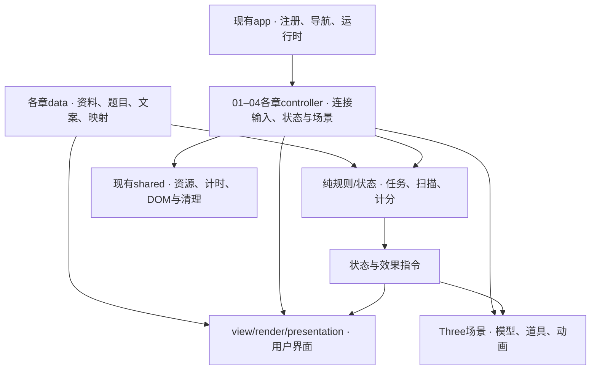

# 01–04 内部结构整理设计

日期：2026-11-08。状态：01–04内部整理已实施，独立审查与最终完整验证通过；执行记录见docs/engineering/domain-expansion-progress.md。

## 1. 用户目标与成功标准

现有网页是给最终用户使用的汽车互动展厅。用户明确要求：**保留现有用户体验，整理内部代码，让内容和小游戏更容易修改。**

本轮重点是降低内容、游戏规则、界面输入与三维表现之间的耦合。最终用户继续使用现有01–04展厅；维护入口在源码和仓库开发文档中。

成功标准：
- 修改某章的资料、题目或实验文案，有明确的内容文件，通常不需要阅读渲染与加载代码。
- 修改任务推进、答案判断或计分，有独立规则/状态函数，可不启动浏览器或Three.js进行验证。
- 调整模型动作或场景表现，沿明确接口消费状态，不保存第二份任务进度或分数。
- 其他章节、导航、原有交互和故障恢复不因章内拆分受到影响。

## 2. 范围与真实基线

技术保留：TypeScript、Vite 6、Three.js 0.180、原生DOM、Vitest 4.1.12、Playwright 1.56.1；保留当前图片、模型、样式与许可。

| 模块 | 保留的用户体验 | 本轮内部整理 |
| --- | --- | --- |
| 01 history | 14件展品、年份跳转、档案图；无测验 | data/view保留，HTML生成抽到render |
| 02 explore | 分类、聚焦、爆炸、开合、灯光、三步找部件和动力故事 | 任务/动力纯状态、模型动作和效果与控制器分开 |
| 03 lidar | 8部件、3种模式、4步扫描、5–80m距离、720点演示 | 测量、实验状态、输入、模型和扫描更新分开 |
| 04 traffic | 原8情境、每题1分、总分8、反馈、过街与继续 | 答题/计分/阶段、道路运动、场景道具和UI分开 |

当前04情境ID为 red-light、pedestrians、yellow-light、school-zone、green-pedestrians、queue、construction、ambulance；数量、顺序、stopZ、答案与选项视觉顺序均保持现状。

现有23项单元测试、11项浏览器测试和构建是实施前的基线；执行时重新运行确认，不能只引用旧验证结果。

本轮不实施学习档案、解锁门禁、新课程、新题库、成绩迁移、05/06页面、设计/报告存储或新路由参数。原始课程建议保留为 [后续扩展参考](C:/Codex/citygame01/docs/superpowers/specs/2026-11-08-future-learning-expansion-reference.md)，不作为本轮依赖或验收。

## 3. 内部架构与职责



依赖边界：
- app继续通过现有注册表加载章节，章节之间不导入彼此控制器。
- 内容文件和纯规则/状态不导入DOM、Three.js或app/bootstrap。
- 控制器负责事件、生命周期和接线；规则负责答案/阶段，场景负责视觉，避免双方维护同一份业务状态。
- 全局导航、菜单、兼容入口、资源取消和错误恢复继续使用已有实现。
- 按职责拆分，不为凑目录创建空模块，不引入统一游戏框架、后台服务或编辑器。

## 4. 四章实施边界

- 01：render.ts导出时间线与档案HTML生成；data.ts继续提供展品与图片映射，view保留外壳，controller只接线年份定位。
- 02：mission-state管三任务；powerflow-state管动力流程；vehicle-rig/powerflow-scene管动作和效果；mission继续提供面板展示。
- 03：measurement管往返时间；experiment-state管模式、距离、扫描步骤与选择；interaction/model-rig/scan-animation管输入、模型动作与画面更新。
- 04：rules管答案、计分、阶段及效果指令；simulation只管本章既有道路运动；scenario-scene按稳定ID设置道具；presentation更新题目与反馈。该simulation.ts是04局部文件。

文件和准确接口在 [当前实施计划](C:/Codex/citygame01/docs/superpowers/plans/2026-11-08-domain-learning-expansion-plan.md) 与四章子计划列明，不改变公共装载契约：

```ts
interface ChapterController {
  setActive(active: boolean): void;
  dispose(): void;
}
mount(host: HTMLElement): ChapterController;
// ChapterDefinition中的装载接口
load(host: HTMLElement, signal?: AbortSignal): Promise<ChapterController>;
```

控制器创建时inactive；旧根目录兼容入口保持现有返回值与自动激活语义。DOM查询与事件限定本章host；所有帧循环、计时器、监听器及模型资源由既有scope清理。

## 5. 必须保留的特殊行为

- 02离开章节会结束正在播放的动力故事并标记已播放，不能改成统一暂停后续播。
- 02动力故事阶段为0/1.2/2.55/3.45秒，总时长5秒；自动旋转恢复2500ms。
- 03隐藏时暂停扫描，不补跑后台时间；手选步骤保持，重新启动扫描从第一步开始。
- 03重置恢复assembly、关闭扫描、回到第一步、清空选择和重置相机，**保留所选距离与滑块值**；60m→重置仍是60m。
- 04普通反馈2300ms、过街4.8s、过街后550ms；后台/切章保留剩余计时，手动和自动继续只推进一次。
- 当前缺图占位、GLB/DAE降级、资源重试、上下文重建和迟到结果清理全部保留。
- 页面排版、按钮、文字、输入方式、菜单、hash及CSS导入顺序保持现状；纯重构不附带重新设计视觉或玩法。

## 6. 内容维护与协作

01–04协作者分别拥有自己的章节目录、独立测试与docs/development/{history,explore,lidar,traffic}-content.md中的对应文件；集成负责人拥有app/shared、公共配置、兼容入口、styles.css及架构文档。公共文件只在有证据需要接线修正时调整，不预建未来服务。

各章实施时创建独立内容指南；集成负责人创建 `docs/engineering/content-editing-guide.md`作为索引，链接四章实际修改路径，逐章列出：
- 资料/题目/文案在哪个data字段修改；
- 任务target或场景ID如何关联模型和道具；
- 计分/阶段/测量算法在哪个纯规则文件修改；
- 画面动作与界面在什么文件修改；
- 内容数量/答案发生业务变更时应同步哪些验证。

该指南是给维护者使用的仓库文档，不增加用户页面上的配置或编辑流程。文案型内容改动主要落在data；新增模型、情境或玩法仍可能需要规则和场景配合，文档应准确指出这些关联。

## 7. 交付验收

先确认基线，再按章拆分，最后集成回归。验收依据为原用户体验一致、纯规则可独立验证、内容修改路径明确、原资源与故障处理继续可用；不以新增文件数或控制器行数作为成功指标。

最终`npm run check`退出0：98项单元测试、TypeScript与生产构建、23项浏览器验收通过。桌面与手机八组稳定布局/控件文案对照本轮源码快照完全一致；验证、审查与保留的原相机阻尼边界详见执行记录。

来源：[当前实际架构](C:/Codex/citygame01/PROJECT_ARCHITECTURE.md)、用户最新明确范围、四章当前源码。
