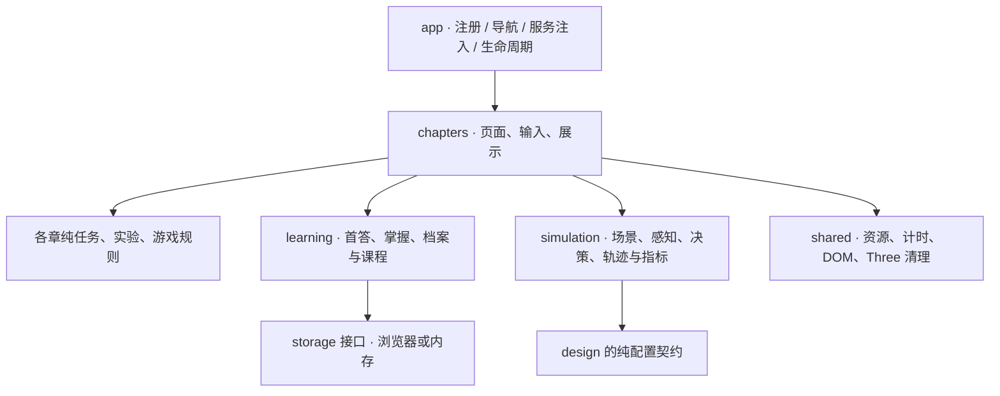

# 学习、设计与仿真扩展设计（历史参考）

日期：2026-11-08。状态：历史参考，已移出当前实施范围。

用户最新确认：保留现有用户体验，只整理内部代码，让内容和小游戏更容易修改。本文件保留先前学习、05/06扩展的讨论，不是当前执行依据。当前范围见 [01–04内部结构整理设计](C:/Codex/citygame01/docs/superpowers/specs/2026-11-08-domain-learning-expansion-design.md) 与 [当前实施计划](C:/Codex/citygame01/docs/superpowers/plans/2026-11-08-domain-learning-expansion-plan.md)。

## 1. 已确认的目标

在现有 `app + chapters + shared` 架构上，继续拆出 01–04 的任务、实验和计分规则，方便分别协作。学习记录集中在 `learning`；05 设计页面位于 `chapters/design`；06 页面位于 `chapters/simulator`，可复用的计算位于 `simulation`。

当前技术与资源保留：TypeScript、Vite 6、Three.js 0.180、原生 DOM、现有图片和模型。验证沿用 Vitest 4.1.12、Playwright 1.56.1、`npm run check`。不新增框架、后端、账号或网络服务。

用户已认可融合方向，要求本版实施计划。05/06 按原始课程建议规划最小可用版本；07 实体组装仅保留路线说明。

## 2. 基线与阶段边界

- A：只做结构拆分。01 保留 14 件展品；02 保留 BatteryPack→ADAS→Cabin 三任务；03 保留结构与扫描演示；04 保留当前八情境，每题 1 分、满分 8。
- B：建立学习底座，并按既有教学设计逐章接入新任务。全部四章任务上线并验收后，才启用正式学习门禁。
- C：实现 05 设计配置、预算校验、不可变提交版本和设计卡。
- D：实现 06 确定性的教学仿真、2D 播放、报告保存和两次配置比较。

当前 04 与新课程是两套内容。新课程为另一套八关、满分 100；01 满分 15，02/03 不设数值成绩。禁止把当前 8 分换算成 100 分，禁止按重合题目 ID 自动迁移成绩。

原教学设计的任务与分值继续采用 [01–04 教学设计](C:/Codex/citygame01/docs/superpowers/specs/2026-11-08-futuredrive-learning-route-design.md)。其中“本轮不实施 05/06”限定的是旧计划的范围；本版 C/D 是单独扩展工作包。旧计划中重拆 S0、创建已有 app 文件、改成 index.ts、安装 Vitest 3 和使用旧 test 命令，均不再执行。

## 3. 依赖与所有权



规则层、学习领域和仿真核心不导入 DOM、Three.js 或 app/bootstrap。章节控制器连接输入、状态、场景与服务；不直接访问 localStorage。01–04 协作者各自拥有章节目录与对应测试；集成负责人拥有 app、learning、公共配置和样式导入清单。

## 4. A：领域拆分约束

生命周期继续使用 `ChapterController { setActive(active: boolean): void; dispose(): void }`。控制器创建时 inactive；旧根目录入口保持兼容。

- 01：将档案和时间线 HTML 生成提取到 render.ts。没有测验，不建立空 rules.ts。
- 02：mission-state 管任务状态；powerflow-state 管动力故事时序；vehicle-rig/powerflow-scene 管模型动作和效果；mission.ts 继续负责面板展示。
- 03：measurement 管距离和往返时间；experiment-state 管模式、距离与扫描步骤；interaction、model-rig、scan-animation 管输入与画面。
- 04：rules 管答题、计分、阶段和效果指令；simulation 管本章既有道路运动；scenario-scene 按稳定 ID 管道具；presentation 管题目和反馈。

保持真实基线中的特殊行为：02 离开章节会结束正在播放的动力故事并标记已播放；03 隐藏时暂停扫描，重置恢复结构模式、扫描/步骤/选择和相机，但保留距离及滑块值；04 普通反馈 2300ms、行人通过后 550ms 的计时均保留剩余时间。不可为统一暂停语义而顺带改变玩法。

A 的验收是业务规则可以独立测试、现有交互一致；不以文件数量或控制器行数作为完成标准。

## 5. B：学习契约

沿用既有课程 `schemaVersion: 1`、`courseVersion: '01-04-v1'`、localStorage 键 `futuredrive.learning.v1`；首次正式实现时增加 `profileId: string`，供设计和报告关联。课程版本不匹配的数据不自动转换。

公共类型与方法沿用旧计划中的 `TaskAssessment`、`TaskAttemptInput`、`TaskProgress`、`ChapterResult`、`LearningProfile`、`LearningStore`，以及：

```ts
type RouteTarget =
  | { chapter: Exclude<ChapterId, 'simulator'> }
  | { chapter: 'simulator'; design?: { designId: string; revision: number } };

interface ChapterContext {
  progress: LearningStore;
  navigate(target: ChapterId | RouteTarget): boolean;
  getRoute(): RouteTarget;
  getMode(): 'learn' | 'browse';
  design?: DesignStore;
  reports?: ReportStore;
}
// 保留 mount(host)；正式应用可以提供第二个参数。
mount(host: HTMLElement, context?: ChapterContext): ChapterController;
```

ChapterId 包含已规划的 history/explore/lidar/traffic/design/simulator；CoreChapterId 只包含前四项。学习任务和首答成绩由 CoreChapterId 的课程定义校验；05/06 的版本化设计和测试报告另存，不混入 115 分课程总成绩。

路由保持简单的 `navigate('history')` 调用，05 测试入口使用 `navigate({ chapter: 'simulator', design: { designId, revision } })`。序列化使用 URLSearchParams 编码查询字段，地址为 `#simulator?designId=...&revision=...`；解析先分开章节和查询，不把完整 fragment 当章节 ID。只有已发布章节可以导航；未知或未发布章节回到 history。正式学习门禁只检查 CoreChapterId，不把已发布的 design/simulator 转成核心章节。

设计引用必须同时有非空 designId 和十进制正整数 revision，revision 为安全整数；重复参数或非法编码拒绝。仅有 `#simulator` 时显示已提交版本选择或去05入口；引用缺项、非法、不存在或属于其他 profile 时显示原因，不运行，也不默默改用最新版本或草稿。有效引用必须跨刷新、后退/前进保持同一 revision；刷新后存储不可恢复时仍按缺失版本处理。

`recordAttempt` 只接收通过输入校验的真实作答；首次成绩不可覆盖。`markTaskMastered` 不增加作答次数，只允许最近答案正确且活动要求完成时掌握。`completeChapter` 按课程目录推导必做任务和首答成绩，拒绝由 UI 伪造完成或总分。

app 拥有服务实例，在 `app/services.ts` 按 `(profileId, mode)` 管理 LearningStore、DesignStore 和 ReportStore，再通过 context 注入。B2 先实现学习服务、路由和上下文；C2/D2 在对应存储实现时分别增加可选 design/reports 字段，不提前创建空业务模块。三个实例寿命均超过章节控制器和 runtime；跨章节、WebGL/运行时重建及模式往返使用同一档案/模式的实例，章节不自行创建存储。“新建研发档案”确认后切换到新 profileId 并重建控制器。

正式学习模式使用三个版本化持久化键；读写失败降级到该页面会话的内存服务并显示保存状态。浏览模式的学习、设计和报告全部使用独立内存服务，不写正式存储；同一页面会话保留，硬刷新丢弃，界面明确提示可用 JSON 导出保留设计/报告。内存降级也不承诺硬刷新恢复。

注册加载链扩展为 `load(host, signal?, context?)`，runtime 本身保持与学习领域无关；app 提供 context。切换学习/浏览模式时销毁原控制器，以目标模式的服务实例和视图重建，防止浏览记录写回正式档案。

损坏 JSON、非法分数、未知任务或课程版本、存储读取/写入失败都不能白屏。恢复已提交记录；不精确恢复车辆坐标或动画帧。正式学习全路线完成前，默认保留可浏览的现有导航。

## 6. C：05 最小设计工坊

四车型：城市 SUV、未来轿车、智能校车、无人配送车。三能源：纯电动、混合动力、氢燃料电池。第一版使用现有车辆或简洁 2D 示意，不要求新增四套 3D 资产。

设备 ID 沿用 `camera-front | camera-surround | lidar | radar | ultrasonic | gnss`；教学预算上限 100 点，费用依次为 10/15/30/25/10/10。设备不可重复，预算从目录计算，不能信任界面传来的总价。

条件：`pedestrian | red-light | construction | heavy-rain | sensor-uncertain`。动作沿用旧课程 `DrivingAction`，按条件限制可选项：pedestrian→yield/slow-stop；red-light→stop；construction→slow-pass/slow-stop；heavy-rain→slow-keep-gap；sensor-uncertain→safe-stop-alert。规则可不配齐，但至少提交一条；缺失规则留给测试解释风险。每个条件最多一条规则，冲突输入拒绝。固定优先级：感知不确定→行人→红灯→施工→暴雨。

`DesignDraft` 保存编辑内容；`DesignRevision` 保存 profileId、designId、单调递增 revision、车型、能源、设备、规则、计算预算、组名、时间与 `designVersion: 1`。提交后不可变；修改草稿或再次提交不改变旧测试输入。

输入需已知车型/能源/设备/条件/动作，小组名去首尾空白后 1–20 字。未知 ID、重复设备、超预算、非法组合只显示校验提示。允许没有传感器的设计，并在测试中解释感知不足。车型和能源在此版本记录为设计属性，仿真暂不计算续航或动力性能。

设计存储键 `futuredrive.design.v1`，保存版本和 profileId，由 app 按第5节的模式策略创建并注入 DesignStore。保存失败继续内存使用并提供 JSON 导出；正式模式仅成功持久化的数据可在硬刷新后恢复，浏览模式不持久化。复习/重测不删除其他配置；“新建研发档案”确认后生成新 profileId，旧报告不参与新档案进度。

## 7. D：06 最小教学仿真

先实现无界面的 `simulate(input): SimulationResult`，再接 2D Canvas 播放。核心输入为不可变设计、场景、seed、`simulationModelVersion: 'teaching-v1'`；输出轨迹、感知事件、决策原因、指标与结束原因。

第一版三个场景：

| 场景 ID | 条件 | 教学判定 |
| --- | --- | --- |
| pedestrian-clear | 晴天，行人经过车道 | 前向摄像头、环视摄像头、激光雷达或毫米波雷达中任一可提供目标线索；yield/slow-stop 且无接触才安全通过 |
| red-light-clear | 晴天，红灯后转绿灯 | 摄像头提供灯色；stop 需等绿灯后继续并到达终点，不能永远停着算完成 |
| pedestrian-heavy-rain | 暴雨，行人经过车道 | 对教学模型中的目标语义和距离线索分别判定；仅有受天气影响的摄像头时为 uncertain，safe-stop-alert 发起制动；足够距离停住且全程无风险才安全，任务未完成 |

GNSS 仅提供定位；超声波只提供近距离线索。不得把没有激光雷达直接当成无法识别行人。具体线索矩阵、场景位置和制动参数在 D1 写成版本化数据，并由单元测试固定，不声称为真实设备的性能。

时间步固定 0.05s，SI 单位，最多 1200 步（60s）；超时明确结束。相同版本、场景、设计和 seed 得到相同轨迹。尚无需要干预的感知条件时继续基础行驶，不记录 missing-rule；已观察到需干预条件却没有配置匹配规则时，才继续基础行驶并记录 missing-rule。红灯正确停车后转绿，恢复基础行驶不应被标成缺失规则。

碰撞和违规从完整轨迹判定并累积，后续动作不能擦除既有风险。safe-stop-alert 仅发起制动，停住且全程没有风险才返回 safety='safe'；制动太晚碰撞或已有违规则 safety='unsafe'。该动作的 missionCompleted=false、passed=false；其他正常任务只有无风险且完成场景任务才 passed=true。未停住而达到时间上限也不能被标记为安全停车。

`SimulationResult` 必须保存 profileId、designId、revision、完整设计快照、场景快照及版本、seed、模型版本、`evaluationVersion: 'teaching-v1'`。报告以同场景、seed、模型和评价版本比较两次设计；条件不一致时明确不能直接比较。

播放只消费轨迹，不参与评分；帧率、暂停和后台时间不改变结果。报告存储键 `futuredrive.simulation.v1`，schemaVersion=1，最多保留最近 30 条；超过上限淘汰最早报告，提供 JSON 导出。app 创建并注入 ReportStore，使用第5节的模式与降级策略。读取时验证 JSON、schema、模型/评价版本、输入快照及 profile；损坏或未知版本记录不成为当前报告，显示原因并允许继续测试。配额失败保留同页面会话的内存结果和导出入口。

## 8. 验收与来源

A 保持当前 `npm run check` 的 23 项单元、11 项浏览器验证，并补齐三拆解任务、八题结算和03重置保留60m。B 验证首答/掌握、课程版本、浏览隔离、存储降级、导航门禁与带版本路由。C 验证预算边界和不可变版本。D 验证确定性、有限结束、配置影响结果、及时/迟到制动、红转绿无误报和三场景比较。联调验证存储被拒绝时05提交→06测试→章节重建后同一版本和报告仍可读。

依据：[当前架构](C:/Codex/citygame01/PROJECT_ARCHITECTURE.md)、[原课程建议](C:/Users/cngal/.codex/attachments/c47975ea-0f3e-43b5-b5cb-b05f96915314/已粘贴的文本.txt)、[原课程设计](C:/Codex/citygame01/docs/superpowers/specs/2026-11-08-futuredrive-learning-route-design.md)。
